# Class Diagram — HL-RCS

Đối chiếu mã nguồn ngày 18/11/2026. Sơ đồ thiết kế lớp backend theo từng chức năng, tương ứng kiểu Controller–Service–Repository–Entity trong mẫu. Frontend React dùng function component nên không biểu diễn thành lớp Java.

Mũi tên `-->`: tham chiếu được inject; `..>`: sử dụng kiểu dữ liệu; `..|>`: hiện thực interface; `--|>`: kế thừa interface. Injection không được biểu diễn bằng composition vì không chứng minh quyền sở hữu vòng đời. Các phương thức được rút gọn tên (không thể hiện overload, tham số, kiểu trả về); entity chỉ hiện tối đa 8 thuộc tính, lớp khác tối đa 7 phương thức để dễ đọc. Getter/setter Lombok được lược bỏ. Sơ đồ chỉ mở rộng một tầng service của controller, không phải toàn bộ call graph.

Các file `.mmd` cùng thư mục có thể chỉnh sửa bằng công cụ hỗ trợ Mermaid. Repository kế thừa JpaRepository với kiểu entity và ID ghi tại liên kết sử dụng. Không suy ra module đã có API chỉ từ sự tồn tại của entity.

## Tài khoản và xác thực

Nguồn: `src/main/java/org/hlrcs/controller/AuthController.java`.

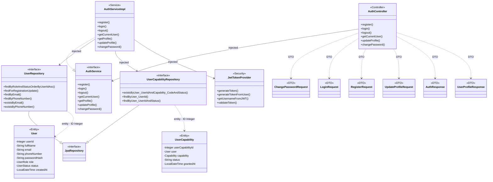

## Tổng quan chủ trọ

Nguồn: `src/main/java/org/hlrcs/controller/HostDashboardController.java`.

```mermaid
classDiagram
    direction TB
    class HostDashboardController {
        <<Controller>>
        +dashboard()
    }
    class HostDashboardService {
        <<Service>>
        +getDashboard()
    }
    class AuthService {
        <<interface>>
        +register()
        +login()
        +logout()
        +getCurrentUser()
        +getProfile()
        +updateProfile()
        +changePassword()
    }
    class PropertyRepository {
        <<interface>>
        +findByOwner_UserIdOrderByPropertyIdAsc()
    }
    class RoomTypeRepository {
        <<interface>>
        +findByProperty_Owner_UserId()
        +existsByProperty_PropertyIdAndRoomTypeIgnoreCase()
        +existsByProperty_PropertyIdAndRoomTypeIgnoreCaseAndRoomTypeIdNot()
    }
    class BookingRepository {
        <<interface>>
        +existsByRoomType_RoomTypeId()
        +countByRoomType_Property_PropertyIdAndStatus()
        +findByRoomType_Property_Owner_UserIdOrderByCreatedAtDesc()
        +countByRoomType_Property_Owner_UserIdAndStatus()
        +findTop5ByRoomType_Property_Owner_UserIdOrderByCreatedAtDesc()
    }
    class PropertyRegistrationRepository {
        <<interface>>
        +findAllByOrderByCreatedAtDesc()
        +findForReview()
        +findByUser_UserIdOrderByCreatedAtDesc()
        +findFirstByUser_UserIdAndStatusOrderByCreatedAtDesc()
        +countByUser_UserIdAndStatus()
    }
    class RoomRepository {
        <<interface>>
        +findByProperty_Owner_UserIdOrderByRoomNumberAsc()
        +findByRoomType_RoomTypeIdOrderByRoomNumberAsc()
        +existsByRoomType_RoomTypeId()
        +existsByProperty_PropertyIdAndRoomNumberIgnoreCaseAndRoomIdNot()
        +countByProperty_PropertyId()
        +countByProperty_PropertyIdAndStatus()
        +countByProperty_Owner_UserId()
    }
    class Property {
        <<Entity>>
        -Integer propertyId
        -User owner
        -PropertyRegistration registration
        -String name
        -String address
        -String contactInfo
        -String googleMapLink
        -String description
    }
    class RoomType {
        <<Entity>>
        -Integer roomTypeId
        -Property property
        -String roomType
        -BigDecimal price
        -Float areaSqm
        -BigDecimal servicePrice
        -String description
        -Integer capacity
    }
    class Booking {
        <<Entity>>
        -Integer bookingId
        -User renter
        -RoomType roomType
        -LocalDateTime scheduledDate
        -BookingStatus status
        -String note
        -LocalDateTime createdAt
    }
    class PropertyRegistration {
        <<Entity>>
        -Integer registrationId
        -User user
        -String name
        -String address
        -String contactInfo
        -String googleMapLink
        -RegistrationStatus status
        -User reviewer
    }
    class Room {
        <<Entity>>
        -Integer roomId
        -Property property
        -RoomType roomType
        -String roomNumber
        -String floor
        -String status
        -BigDecimal customPrice
        -LocalDateTime confirmedAt
    }
    class HostDashboardResponse {
        <<DTO>>
    }
    class JpaRepository {
        <<interface>>
    }
    HostDashboardController --> HostDashboardService : injected
    HostDashboardService --> AuthService : injected
    HostDashboardService --> PropertyRepository : injected
    HostDashboardService --> RoomTypeRepository : injected
    HostDashboardService --> BookingRepository : injected
    HostDashboardService --> PropertyRegistrationRepository : injected
    HostDashboardService --> RoomRepository : injected
    PropertyRepository --|> JpaRepository
    PropertyRepository ..> Property : entity - ID Integer
    RoomTypeRepository --|> JpaRepository
    RoomTypeRepository ..> RoomType : entity - ID Integer
    BookingRepository --|> JpaRepository
    BookingRepository ..> Booking : entity - ID Integer
    PropertyRegistrationRepository --|> JpaRepository
    PropertyRegistrationRepository ..> PropertyRegistration : entity - ID Integer
    RoomRepository --|> JpaRepository
    RoomRepository ..> Room : entity - ID Integer
    HostDashboardController ..> HostDashboardResponse : DTO
```

## Thông tin nhà trọ

Nguồn: `src/main/java/org/hlrcs/controller/HostPropertyController.java`.

```mermaid
classDiagram
    direction TB
    class HostPropertyController {
        <<Controller>>
        +getProperty()
        +photo()
    }
    class HostPropertyService {
        <<Service>>
        +getProperties()
        +getPhoto()
    }
    class AuthService {
        <<interface>>
        +register()
        +login()
        +logout()
        +getCurrentUser()
        +getProfile()
        +updateProfile()
        +changePassword()
    }
    class PropertyRepository {
        <<interface>>
        +findByOwner_UserIdOrderByPropertyIdAsc()
    }
    class PropertyRegistrationRepository {
        <<interface>>
        +findAllByOrderByCreatedAtDesc()
        +findForReview()
        +findByUser_UserIdOrderByCreatedAtDesc()
        +findFirstByUser_UserIdAndStatusOrderByCreatedAtDesc()
        +countByUser_UserIdAndStatus()
    }
    class PropertyDocumentRepository {
        <<interface>>
        +getDocumentId()
        +getDocumentType()
        +getFileName()
        +getContentType()
        +getVerificationStatus()
        +findByRegistration_RegistrationIdOrderByDocumentIdAsc()
        +existsByRegistration_RegistrationIdAndDocumentTypeAndFileContentIsNotNull()
    }
    class RoomTypeRepository {
        <<interface>>
        +findByProperty_Owner_UserId()
        +existsByProperty_PropertyIdAndRoomTypeIgnoreCase()
        +existsByProperty_PropertyIdAndRoomTypeIgnoreCaseAndRoomTypeIdNot()
    }
    class BookingRepository {
        <<interface>>
        +existsByRoomType_RoomTypeId()
        +countByRoomType_Property_PropertyIdAndStatus()
        +findByRoomType_Property_Owner_UserIdOrderByCreatedAtDesc()
        +countByRoomType_Property_Owner_UserIdAndStatus()
        +findTop5ByRoomType_Property_Owner_UserIdOrderByCreatedAtDesc()
    }
    class RoomRepository {
        <<interface>>
        +findByProperty_Owner_UserIdOrderByRoomNumberAsc()
        +findByRoomType_RoomTypeIdOrderByRoomNumberAsc()
        +existsByRoomType_RoomTypeId()
        +existsByProperty_PropertyIdAndRoomNumberIgnoreCaseAndRoomIdNot()
        +countByProperty_PropertyId()
        +countByProperty_PropertyIdAndStatus()
        +countByProperty_Owner_UserId()
    }
    class Property {
        <<Entity>>
        -Integer propertyId
        -User owner
        -PropertyRegistration registration
        -String name
        -String address
        -String contactInfo
        -String googleMapLink
        -String description
    }
    class PropertyRegistration {
        <<Entity>>
        -Integer registrationId
        -User user
        -String name
        -String address
        -String contactInfo
        -String googleMapLink
        -RegistrationStatus status
        -User reviewer
    }
    class PropertyDocument {
        <<Entity>>
        -Integer documentId
        -PropertyRegistration registration
        -String documentType
        -String documentUrl
        -String verificationStatus
        -String fileName
        -String contentType
        -byte[] fileContent
    }
    class RoomType {
        <<Entity>>
        -Integer roomTypeId
        -Property property
        -String roomType
        -BigDecimal price
        -Float areaSqm
        -BigDecimal servicePrice
        -String description
        -Integer capacity
    }
    class Booking {
        <<Entity>>
        -Integer bookingId
        -User renter
        -RoomType roomType
        -LocalDateTime scheduledDate
        -BookingStatus status
        -String note
        -LocalDateTime createdAt
    }
    class Room {
        <<Entity>>
        -Integer roomId
        -Property property
        -RoomType roomType
        -String roomNumber
        -String floor
        -String status
        -BigDecimal customPrice
        -LocalDateTime confirmedAt
    }
    class HostPropertyResponse {
        <<DTO>>
    }
    class JpaRepository {
        <<interface>>
    }
    HostPropertyController --> HostPropertyService : injected
    HostPropertyService --> AuthService : injected
    HostPropertyService --> PropertyRepository : injected
    HostPropertyService --> PropertyRegistrationRepository : injected
    HostPropertyService --> PropertyDocumentRepository : injected
    HostPropertyService --> RoomTypeRepository : injected
    HostPropertyService --> BookingRepository : injected
    HostPropertyService --> RoomRepository : injected
    PropertyRepository --|> JpaRepository
    PropertyRepository ..> Property : entity - ID Integer
    PropertyRegistrationRepository --|> JpaRepository
    PropertyRegistrationRepository ..> PropertyRegistration : entity - ID Integer
    PropertyDocumentRepository --|> JpaRepository
    PropertyDocumentRepository ..> PropertyDocument : entity - ID Integer
    RoomTypeRepository --|> JpaRepository
    RoomTypeRepository ..> RoomType : entity - ID Integer
    BookingRepository --|> JpaRepository
    BookingRepository ..> Booking : entity - ID Integer
    RoomRepository --|> JpaRepository
    RoomRepository ..> Room : entity - ID Integer
    HostPropertyController ..> HostPropertyResponse : DTO
```

## Loại phòng

Nguồn: `src/main/java/org/hlrcs/controller/HostRoomTypeController.java`.

```mermaid
classDiagram
    direction TB
    class HostRoomTypeController {
        <<Controller>>
        +create()
        +createWithImages()
        +update()
        +detail()
        +delete()
        +image()
        +getRoomTypes()
    }
    class HostRoomTypeService {
        <<Service>>
        +create()
        +save()
        +detail()
        +image()
        +delete()
        +getRoomTypes()
    }
    class AuthService {
        <<interface>>
        +register()
        +login()
        +logout()
        +getCurrentUser()
        +getProfile()
        +updateProfile()
        +changePassword()
    }
    class PropertyRepository {
        <<interface>>
        +findByOwner_UserIdOrderByPropertyIdAsc()
    }
    class PropertyRegistrationRepository {
        <<interface>>
        +findAllByOrderByCreatedAtDesc()
        +findForReview()
        +findByUser_UserIdOrderByCreatedAtDesc()
        +findFirstByUser_UserIdAndStatusOrderByCreatedAtDesc()
        +countByUser_UserIdAndStatus()
    }
    class RoomTypeRepository {
        <<interface>>
        +findByProperty_Owner_UserId()
        +existsByProperty_PropertyIdAndRoomTypeIgnoreCase()
        +existsByProperty_PropertyIdAndRoomTypeIgnoreCaseAndRoomTypeIdNot()
    }
    class UserRepository {
        <<interface>>
        +findByRoleAndStatusOrderByUserIdAsc()
        +findForRegistrationUpdate()
        +findByEmail()
        +findByPhoneNumber()
        +existsByEmail()
        +existsByPhoneNumber()
    }
    class RoomTypeImageRepository {
        <<interface>>
        +findByRoomType_RoomTypeIdOrderByImageIdAsc()
        +deleteByRoomType_RoomTypeId()
    }
    class BookingRepository {
        <<interface>>
        +existsByRoomType_RoomTypeId()
        +countByRoomType_Property_PropertyIdAndStatus()
        +findByRoomType_Property_Owner_UserIdOrderByCreatedAtDesc()
        +countByRoomType_Property_Owner_UserIdAndStatus()
        +findTop5ByRoomType_Property_Owner_UserIdOrderByCreatedAtDesc()
    }
    class RoomTypeVideoRepository {
        <<interface>>
        +deleteByRoomType_RoomTypeId()
    }
    class RoomTypeAmenityRepository {
        <<interface>>
        +deleteByRoomType_RoomTypeId()
    }
    class WishlistRepository {
        <<interface>>
        +deleteByRoomType_RoomTypeId()
    }
    class RoomRepository {
        <<interface>>
        +findByProperty_Owner_UserIdOrderByRoomNumberAsc()
        +findByRoomType_RoomTypeIdOrderByRoomNumberAsc()
        +existsByRoomType_RoomTypeId()
        +existsByProperty_PropertyIdAndRoomNumberIgnoreCaseAndRoomIdNot()
        +countByProperty_PropertyId()
        +countByProperty_PropertyIdAndStatus()
        +countByProperty_Owner_UserId()
    }
    class RoomMapping {
        <<Service>>
        +summary()
    }
    class Property {
        <<Entity>>
        -Integer propertyId
        -User owner
        -PropertyRegistration registration
        -String name
        -String address
        -String contactInfo
        -String googleMapLink
        -String description
    }
    class PropertyRegistration {
        <<Entity>>
        -Integer registrationId
        -User user
        -String name
        -String address
        -String contactInfo
        -String googleMapLink
        -RegistrationStatus status
        -User reviewer
    }
    class RoomType {
        <<Entity>>
        -Integer roomTypeId
        -Property property
        -String roomType
        -BigDecimal price
        -Float areaSqm
        -BigDecimal servicePrice
        -String description
        -Integer capacity
    }
    class User {
        <<Entity>>
        -Integer userId
        -String fullName
        -String email
        -String phoneNumber
        -String passwordHash
        -UserRole role
        -UserStatus status
        -LocalDateTime createdAt
    }
    class RoomTypeImage {
        <<Entity>>
        -Integer imageId
        -RoomType roomType
        -String imageUrl
        -String fileName
        -String contentType
        -byte[] fileContent
    }
    class Booking {
        <<Entity>>
        -Integer bookingId
        -User renter
        -RoomType roomType
        -LocalDateTime scheduledDate
        -BookingStatus status
        -String note
        -LocalDateTime createdAt
    }
    class RoomTypeVideo {
        <<Entity>>
        -Integer videoId
        -RoomType roomType
        -String videoUrl
    }
    class RoomTypeAmenity {
        <<Entity>>
        -RoomTypeAmenityId id
        -RoomType roomType
        -Amenity amenity
    }
    class Wishlist {
        <<Entity>>
        -Integer wishlistId
        -User user
        -RoomType roomType
        -LocalDateTime createdAt
    }
    class Room {
        <<Entity>>
        -Integer roomId
        -Property property
        -RoomType roomType
        -String roomNumber
        -String floor
        -String status
        -BigDecimal customPrice
        -LocalDateTime confirmedAt
    }
    class HostRoomTypesResponse {
        <<DTO>>
    }
    class JpaRepository {
        <<interface>>
    }
    HostRoomTypeController --> HostRoomTypeService : injected
    HostRoomTypeService --> AuthService : injected
    HostRoomTypeService --> PropertyRepository : injected
    HostRoomTypeService --> PropertyRegistrationRepository : injected
    HostRoomTypeService --> RoomTypeRepository : injected
    HostRoomTypeService --> UserRepository : injected
    HostRoomTypeService --> RoomTypeImageRepository : injected
    HostRoomTypeService --> BookingRepository : injected
    HostRoomTypeService --> RoomTypeVideoRepository : injected
    HostRoomTypeService --> RoomTypeAmenityRepository : injected
    HostRoomTypeService --> WishlistRepository : injected
    HostRoomTypeService --> RoomRepository : injected
    HostRoomTypeService --> RoomMapping : injected
    PropertyRepository --|> JpaRepository
    PropertyRepository ..> Property : entity - ID Integer
    PropertyRegistrationRepository --|> JpaRepository
    PropertyRegistrationRepository ..> PropertyRegistration : entity - ID Integer
    RoomTypeRepository --|> JpaRepository
    RoomTypeRepository ..> RoomType : entity - ID Integer
    UserRepository --|> JpaRepository
    UserRepository ..> User : entity - ID Integer
    RoomTypeImageRepository --|> JpaRepository
    RoomTypeImageRepository ..> RoomTypeImage : entity - ID Integer
    BookingRepository --|> JpaRepository
    BookingRepository ..> Booking : entity - ID Integer
    RoomTypeVideoRepository --|> JpaRepository
    RoomTypeVideoRepository ..> RoomTypeVideo : entity - ID Integer
    RoomTypeAmenityRepository --|> JpaRepository
    RoomTypeAmenityRepository ..> RoomTypeAmenity : entity - ID RoomTypeAmenityId
    WishlistRepository --|> JpaRepository
    WishlistRepository ..> Wishlist : entity - ID Integer
    RoomRepository --|> JpaRepository
    RoomRepository ..> Room : entity - ID Integer
    HostRoomTypeController ..> HostRoomTypesResponse : DTO
```

## Phòng

Nguồn: `src/main/java/org/hlrcs/controller/HostRoomsController.java`.

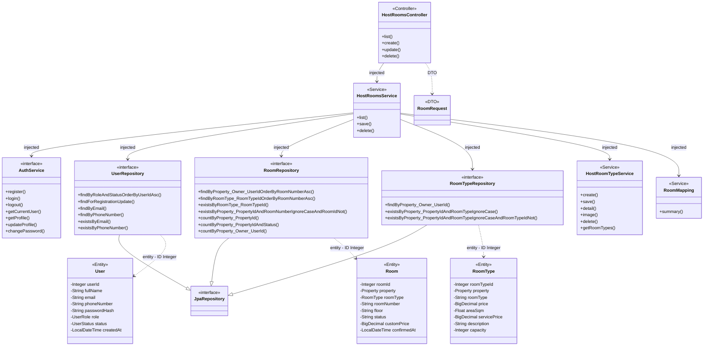

## Lịch xem phòng

Nguồn: `src/main/java/org/hlrcs/controller/HostViewingController.java`.

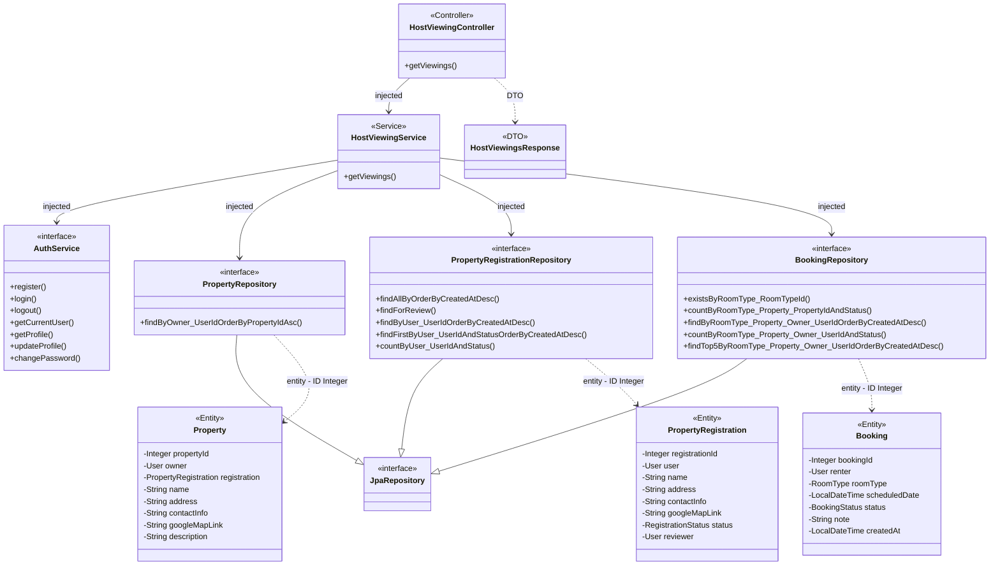

## Đăng ký nhà trọ

Nguồn: `src/main/java/org/hlrcs/controller/PropertyRegistrationController.java`.

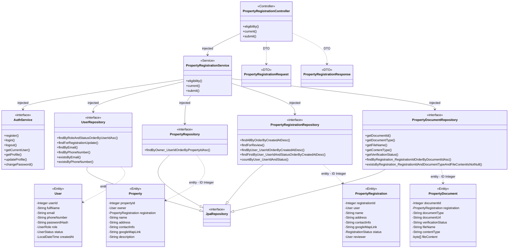

## Nhân viên và duyệt nhà trọ

Nguồn: `src/main/java/org/hlrcs/controller/StaffController.java`.

```mermaid
classDiagram
    direction TB
    class StaffController {
        <<Controller>>
        +dashboard()
        +verifications()
        +detail()
        +file()
        +review()
    }
    class StaffService {
        <<Service>>
        +verifications()
        +detail()
        +file()
        +review()
        +dashboard()
    }
    class AuthService {
        <<interface>>
        +register()
        +login()
        +logout()
        +getCurrentUser()
        +getProfile()
        +updateProfile()
        +changePassword()
    }
    class UserRepository {
        <<interface>>
        +findByRoleAndStatusOrderByUserIdAsc()
        +findForRegistrationUpdate()
        +findByEmail()
        +findByPhoneNumber()
        +existsByEmail()
        +existsByPhoneNumber()
    }
    class PropertyRegistrationRepository {
        <<interface>>
        +findAllByOrderByCreatedAtDesc()
        +findForReview()
        +findByUser_UserIdOrderByCreatedAtDesc()
        +findFirstByUser_UserIdAndStatusOrderByCreatedAtDesc()
        +countByUser_UserIdAndStatus()
    }
    class PropertyDocumentRepository {
        <<interface>>
        +getDocumentId()
        +getDocumentType()
        +getFileName()
        +getContentType()
        +getVerificationStatus()
        +findByRegistration_RegistrationIdOrderByDocumentIdAsc()
        +existsByRegistration_RegistrationIdAndDocumentTypeAndFileContentIsNotNull()
    }
    class PropertyRepository {
        <<interface>>
        +findByOwner_UserIdOrderByPropertyIdAsc()
    }
    class ModerationLogRepository {
        <<interface>>
        +findAllByOrderByCreatedAtDesc()
        +findByTargetTypeAndTargetIdOrderByCreatedAtDesc()
    }
    class ReportRepository {
        <<interface>>
        +findAllByOrderByCreatedAtAsc()
    }
    class SupportRequestRepository {
        <<interface>>
        +findAllByOrderByCreatedAtAsc()
    }
    class PostRepository {
        <<interface>>
        +findAllByOrderByCreatedAtAsc()
    }
    class ServiceRegistrationRepository {
        <<interface>>
        +existsByTargetService_ServiceIdAndStatusIn()
        +existsByUser_UserIdAndServiceNameIgnoreCaseAndStatusIn()
        +findForReview()
        +findAllByOrderByRegistrationIdDesc()
        +findByAssignedStaff_UserIdOrderByRegistrationIdDesc()
        +findByUser_UserIdOrderByRegistrationIdDesc()
        +existsByUser_UserIdAndStatusIn()
    }
    class ServiceComplaintRepository {
        <<interface>>
        +findAllByOrderByComplaintIdDesc()
        +findByService_Provider_UserIdOrderByComplaintIdDesc()
        +findByReporter_UserIdOrderByComplaintIdDesc()
        +existsByService_ServiceIdAndReporter_UserIdAndStatusIn()
        +findForReview()
    }
    class User {
        <<Entity>>
        -Integer userId
        -String fullName
        -String email
        -String phoneNumber
        -String passwordHash
        -UserRole role
        -UserStatus status
        -LocalDateTime createdAt
    }
    class PropertyRegistration {
        <<Entity>>
        -Integer registrationId
        -User user
        -String name
        -String address
        -String contactInfo
        -String googleMapLink
        -RegistrationStatus status
        -User reviewer
    }
    class PropertyDocument {
        <<Entity>>
        -Integer documentId
        -PropertyRegistration registration
        -String documentType
        -String documentUrl
        -String verificationStatus
        -String fileName
        -String contentType
        -byte[] fileContent
    }
    class Property {
        <<Entity>>
        -Integer propertyId
        -User owner
        -PropertyRegistration registration
        -String name
        -String address
        -String contactInfo
        -String googleMapLink
        -String description
    }
    class ModerationLog {
        <<Entity>>
        -Integer logId
        -User staff
        -String targetType
        -Integer targetId
        -String action
        -String note
        -LocalDateTime createdAt
    }
    class Report {
        <<Entity>>
        -Integer reportId
        -User reporter
        -ReportTargetType targetType
        -Integer targetId
        -String reason
        -ReportStatus status
        -User handler
        -LocalDateTime createdAt
    }
    class SupportRequest {
        <<Entity>>
        -Integer requestId
        -User requester
        -Property targetProperty
        -String requestType
        -String description
        -SupportStatus status
        -LocalDateTime createdAt
        -LocalDateTime completedAt
    }
    class Post {
        <<Entity>>
        -Integer postId
        -User author
        -PostType postType
        -String title
        -String description
        -PostStatus status
        -User reviewer
        -LocalDateTime reviewedAt
    }
    class ServiceRegistration {
        <<Entity>>
        -Integer registrationId
        -User user
        -ServiceCategory category
        -String serviceName
        -String contactInfo
        -String applicantName
        -String contactEmail
        -String pricingType
    }
    class ServiceComplaint {
        <<Entity>>
        -Integer complaintId
        -Service service
        -User reporter
        -String content
        -String status
        -Instant createdAt
        -int revision
        -List~ServiceImage~ images
    }
    class JpaRepository {
        <<interface>>
    }
    StaffController --> StaffService : injected
    StaffService --> AuthService : injected
    StaffService --> UserRepository : injected
    StaffService --> PropertyRegistrationRepository : injected
    StaffService --> PropertyDocumentRepository : injected
    StaffService --> PropertyRepository : injected
    StaffService --> ModerationLogRepository : injected
    StaffService --> ReportRepository : injected
    StaffService --> SupportRequestRepository : injected
    StaffService --> PostRepository : injected
    StaffService --> ServiceRegistrationRepository : injected
    StaffService --> ServiceComplaintRepository : injected
    UserRepository --|> JpaRepository
    UserRepository ..> User : entity - ID Integer
    PropertyRegistrationRepository --|> JpaRepository
    PropertyRegistrationRepository ..> PropertyRegistration : entity - ID Integer
    PropertyDocumentRepository --|> JpaRepository
    PropertyDocumentRepository ..> PropertyDocument : entity - ID Integer
    PropertyRepository --|> JpaRepository
    PropertyRepository ..> Property : entity - ID Integer
    ModerationLogRepository --|> JpaRepository
    ModerationLogRepository ..> ModerationLog : entity - ID Integer
    ReportRepository --|> JpaRepository
    ReportRepository ..> Report : entity - ID Integer
    SupportRequestRepository --|> JpaRepository
    SupportRequestRepository ..> SupportRequest : entity - ID Integer
    PostRepository --|> JpaRepository
    PostRepository ..> Post : entity - ID Integer
    ServiceRegistrationRepository --|> JpaRepository
    ServiceRegistrationRepository ..> ServiceRegistration : entity - ID Integer
    ServiceComplaintRepository --|> JpaRepository
    ServiceComplaintRepository ..> ServiceComplaint : entity - ID Integer
```

## Danh sách dịch vụ công khai

Nguồn: `src/main/java/org/hlrcs/controller/PublicServiceController.java`.

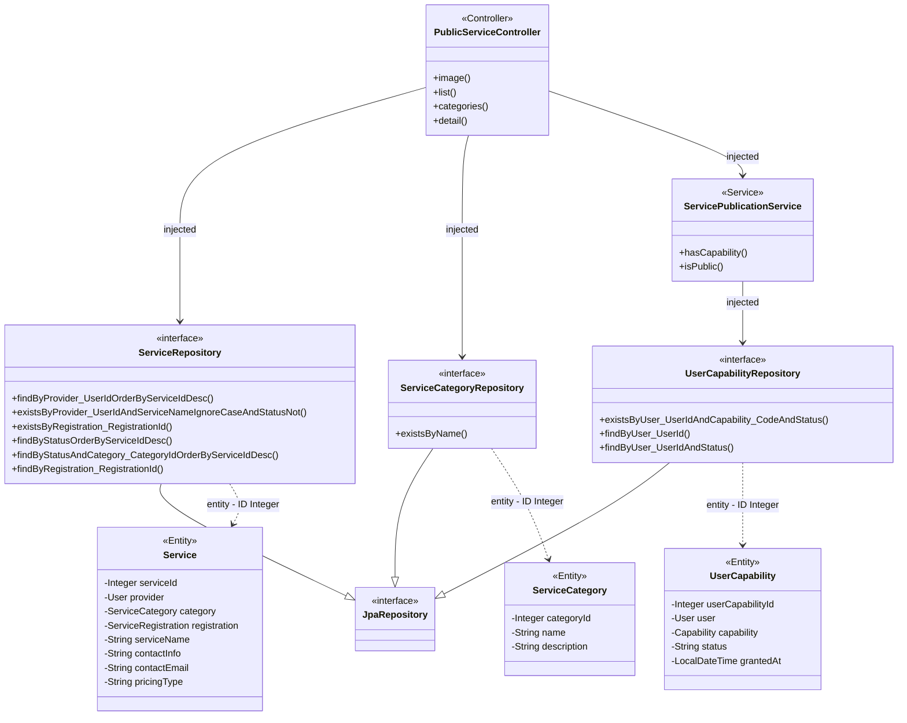

## Hồ sơ và quản lý dịch vụ

Nguồn: `src/main/java/org/hlrcs/controller/ServiceRegistrationController.java`.

```mermaid
classDiagram
    direction TB
    class ServiceRegistrationController {
        <<Controller>>
        +cancel()
        +categories()
        +current()
        +mine()
        +myServices()
        +change()
        +image()
    }
    class ServiceRegistrationService {
        <<Service>>
        +current()
        +mine()
        +myServices()
        +canManage()
        +cancel()
        +change()
        +image()
    }
    class ServiceCategoryRepository {
        <<interface>>
        +existsByName()
    }
    class AuthService {
        <<interface>>
        +register()
        +login()
        +logout()
        +getCurrentUser()
        +getProfile()
        +updateProfile()
        +changePassword()
    }
    class UserRepository {
        <<interface>>
        +findByRoleAndStatusOrderByUserIdAsc()
        +findForRegistrationUpdate()
        +findByEmail()
        +findByPhoneNumber()
        +existsByEmail()
        +existsByPhoneNumber()
    }
    class ServiceRegistrationRepository {
        <<interface>>
        +existsByTargetService_ServiceIdAndStatusIn()
        +existsByUser_UserIdAndServiceNameIgnoreCaseAndStatusIn()
        +findForReview()
        +findAllByOrderByRegistrationIdDesc()
        +findByAssignedStaff_UserIdOrderByRegistrationIdDesc()
        +findByUser_UserIdOrderByRegistrationIdDesc()
        +existsByUser_UserIdAndStatusIn()
    }
    class ServiceDocumentRepository {
        <<interface>>
        +findByRegistration_RegistrationIdOrderByDocumentIdAsc()
        +findByDocumentIdAndRegistration_User_UserId()
    }
    class ServiceRepository {
        <<interface>>
        +findByProvider_UserIdOrderByServiceIdDesc()
        +existsByProvider_UserIdAndServiceNameIgnoreCaseAndStatusNot()
        +existsByRegistration_RegistrationId()
        +findByStatusOrderByServiceIdDesc()
        +findByStatusAndCategory_CategoryIdOrderByServiceIdDesc()
        +findByRegistration_RegistrationId()
    }
    class ServicePublicationService {
        <<Service>>
        +hasCapability()
        +isPublic()
    }
    class ModerationLogRepository {
        <<interface>>
        +findAllByOrderByCreatedAtDesc()
        +findByTargetTypeAndTargetIdOrderByCreatedAtDesc()
    }
    class ServiceCategory {
        <<Entity>>
        -Integer categoryId
        -String name
        -String description
    }
    class User {
        <<Entity>>
        -Integer userId
        -String fullName
        -String email
        -String phoneNumber
        -String passwordHash
        -UserRole role
        -UserStatus status
        -LocalDateTime createdAt
    }
    class ServiceRegistration {
        <<Entity>>
        -Integer registrationId
        -User user
        -ServiceCategory category
        -String serviceName
        -String contactInfo
        -String applicantName
        -String contactEmail
        -String pricingType
    }
    class ServiceDocument {
        <<Entity>>
        -Integer documentId
        -ServiceRegistration registration
        -String documentName
        -String documentUrl
        -String verificationStatus
        -String contentType
        -byte[] fileContent
    }
    class Service {
        <<Entity>>
        -Integer serviceId
        -User provider
        -ServiceCategory category
        -ServiceRegistration registration
        -String serviceName
        -String contactInfo
        -String contactEmail
        -String pricingType
    }
    class ModerationLog {
        <<Entity>>
        -Integer logId
        -User staff
        -String targetType
        -Integer targetId
        -String action
        -String note
        -LocalDateTime createdAt
    }
    class ServiceRegistrationRequest {
        <<DTO>>
    }
    class ServiceResubmissionRequest {
        <<DTO>>
    }
    class JpaRepository {
        <<interface>>
    }
    ServiceRegistrationController --> ServiceRegistrationService : injected
    ServiceRegistrationController --> ServiceCategoryRepository : injected
    ServiceRegistrationService --> AuthService : injected
    ServiceRegistrationService --> UserRepository : injected
    ServiceRegistrationService --> ServiceCategoryRepository : injected
    ServiceRegistrationService --> ServiceRegistrationRepository : injected
    ServiceRegistrationService --> ServiceDocumentRepository : injected
    ServiceRegistrationService --> ServiceRepository : injected
    ServiceRegistrationService --> ServicePublicationService : injected
    ServiceRegistrationService --> ModerationLogRepository : injected
    ServiceCategoryRepository --|> JpaRepository
    ServiceCategoryRepository ..> ServiceCategory : entity - ID Integer
    UserRepository --|> JpaRepository
    UserRepository ..> User : entity - ID Integer
    ServiceRegistrationRepository --|> JpaRepository
    ServiceRegistrationRepository ..> ServiceRegistration : entity - ID Integer
    ServiceDocumentRepository --|> JpaRepository
    ServiceDocumentRepository ..> ServiceDocument : entity - ID Integer
    ServiceRepository --|> JpaRepository
    ServiceRepository ..> Service : entity - ID Integer
    ModerationLogRepository --|> JpaRepository
    ModerationLogRepository ..> ModerationLog : entity - ID Integer
    ServiceRegistrationController ..> ServiceRegistrationRequest : DTO
    ServiceRegistrationController ..> ServiceResubmissionRequest : DTO
```

## Xét duyệt hồ sơ dịch vụ

Nguồn: `src/main/java/org/hlrcs/controller/ServiceReviewController.java`.

```mermaid
classDiagram
    direction TB
    class ServiceReviewController {
        <<Controller>>
        +supplement()
        +list()
        +detail()
        +review()
        +file()
    }
    class ServiceReviewService {
        <<Service>>
        +list()
        +detail()
        +file()
        +review()
        +requestSupplement()
    }
    class AuthService {
        <<interface>>
        +register()
        +login()
        +logout()
        +getCurrentUser()
        +getProfile()
        +updateProfile()
        +changePassword()
    }
    class UserRepository {
        <<interface>>
        +findByRoleAndStatusOrderByUserIdAsc()
        +findForRegistrationUpdate()
        +findByEmail()
        +findByPhoneNumber()
        +existsByEmail()
        +existsByPhoneNumber()
    }
    class ServiceRegistrationRepository {
        <<interface>>
        +existsByTargetService_ServiceIdAndStatusIn()
        +existsByUser_UserIdAndServiceNameIgnoreCaseAndStatusIn()
        +findForReview()
        +findAllByOrderByRegistrationIdDesc()
        +findByAssignedStaff_UserIdOrderByRegistrationIdDesc()
        +findByUser_UserIdOrderByRegistrationIdDesc()
        +existsByUser_UserIdAndStatusIn()
    }
    class ServiceDocumentRepository {
        <<interface>>
        +findByRegistration_RegistrationIdOrderByDocumentIdAsc()
        +findByDocumentIdAndRegistration_User_UserId()
    }
    class ServiceRepository {
        <<interface>>
        +findByProvider_UserIdOrderByServiceIdDesc()
        +existsByProvider_UserIdAndServiceNameIgnoreCaseAndStatusNot()
        +existsByRegistration_RegistrationId()
        +findByStatusOrderByServiceIdDesc()
        +findByStatusAndCategory_CategoryIdOrderByServiceIdDesc()
        +findByRegistration_RegistrationId()
    }
    class UserCapabilityRepository {
        <<interface>>
        +existsByUser_UserIdAndCapability_CodeAndStatus()
        +findByUser_UserId()
        +findByUser_UserIdAndStatus()
    }
    class CapabilityRepository {
        <<interface>>
        +findByCode()
        +existsByCode()
    }
    class ModerationLogRepository {
        <<interface>>
        +findAllByOrderByCreatedAtDesc()
        +findByTargetTypeAndTargetIdOrderByCreatedAtDesc()
    }
    class ServiceRegistrationService {
        <<Service>>
        +current()
        +mine()
        +myServices()
        +canManage()
        +cancel()
        +change()
        +image()
    }
    class User {
        <<Entity>>
        -Integer userId
        -String fullName
        -String email
        -String phoneNumber
        -String passwordHash
        -UserRole role
        -UserStatus status
        -LocalDateTime createdAt
    }
    class ServiceRegistration {
        <<Entity>>
        -Integer registrationId
        -User user
        -ServiceCategory category
        -String serviceName
        -String contactInfo
        -String applicantName
        -String contactEmail
        -String pricingType
    }
    class ServiceDocument {
        <<Entity>>
        -Integer documentId
        -ServiceRegistration registration
        -String documentName
        -String documentUrl
        -String verificationStatus
        -String contentType
        -byte[] fileContent
    }
    class Service {
        <<Entity>>
        -Integer serviceId
        -User provider
        -ServiceCategory category
        -ServiceRegistration registration
        -String serviceName
        -String contactInfo
        -String contactEmail
        -String pricingType
    }
    class UserCapability {
        <<Entity>>
        -Integer userCapabilityId
        -User user
        -Capability capability
        -String status
        -LocalDateTime grantedAt
    }
    class Capability {
        <<Entity>>
        -Integer capabilityId
        -String name
        -String code
    }
    class ModerationLog {
        <<Entity>>
        -Integer logId
        -User staff
        -String targetType
        -Integer targetId
        -String action
        -String note
        -LocalDateTime createdAt
    }
    class JpaRepository {
        <<interface>>
    }
    ServiceReviewController --> ServiceReviewService : injected
    ServiceReviewService --> AuthService : injected
    ServiceReviewService --> UserRepository : injected
    ServiceReviewService --> ServiceRegistrationRepository : injected
    ServiceReviewService --> ServiceDocumentRepository : injected
    ServiceReviewService --> ServiceRepository : injected
    ServiceReviewService --> UserCapabilityRepository : injected
    ServiceReviewService --> CapabilityRepository : injected
    ServiceReviewService --> ModerationLogRepository : injected
    ServiceReviewService --> ServiceRegistrationService : injected
    UserRepository --|> JpaRepository
    UserRepository ..> User : entity - ID Integer
    ServiceRegistrationRepository --|> JpaRepository
    ServiceRegistrationRepository ..> ServiceRegistration : entity - ID Integer
    ServiceDocumentRepository --|> JpaRepository
    ServiceDocumentRepository ..> ServiceDocument : entity - ID Integer
    ServiceRepository --|> JpaRepository
    ServiceRepository ..> Service : entity - ID Integer
    UserCapabilityRepository --|> JpaRepository
    UserCapabilityRepository ..> UserCapability : entity - ID Integer
    CapabilityRepository --|> JpaRepository
    CapabilityRepository ..> Capability : entity - ID Integer
    ModerationLogRepository --|> JpaRepository
    ModerationLogRepository ..> ModerationLog : entity - ID Integer
```

## Yêu cầu sử dụng dịch vụ

Nguồn: `src/main/java/org/hlrcs/controller/ServiceRequestController.java`.

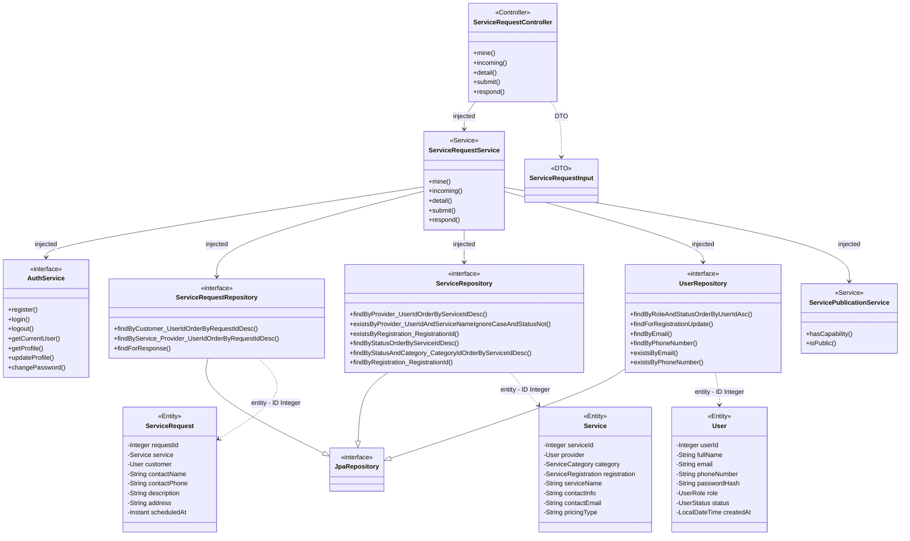

## Đánh giá dịch vụ

Nguồn: `src/main/java/org/hlrcs/controller/ServiceRatingController.java`.

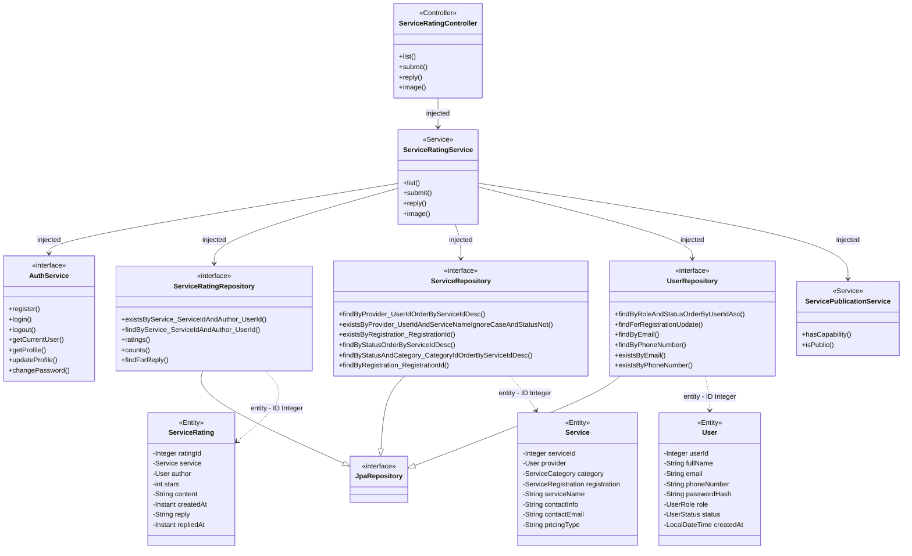

## Báo cáo và xử lý vi phạm dịch vụ

Nguồn: `src/main/java/org/hlrcs/controller/ServiceComplaintController.java`.

```mermaid
classDiagram
    direction TB
    class ServiceComplaintController {
        <<Controller>>
        +mine()
        +incoming()
        +list()
        +detail()
        +submit()
        +explain()
        +review()
    }
    class ServiceComplaintService {
        <<Service>>
        +list()
        +detail()
        +submit()
        +explain()
        +review()
        +image()
    }
    class AuthService {
        <<interface>>
        +register()
        +login()
        +logout()
        +getCurrentUser()
        +getProfile()
        +updateProfile()
        +changePassword()
    }
    class ServiceComplaintRepository {
        <<interface>>
        +findAllByOrderByComplaintIdDesc()
        +findByService_Provider_UserIdOrderByComplaintIdDesc()
        +findByReporter_UserIdOrderByComplaintIdDesc()
        +existsByService_ServiceIdAndReporter_UserIdAndStatusIn()
        +findForReview()
    }
    class ServiceComplaintEventRepository {
        <<interface>>
        +findByComplaint_ComplaintIdOrderByEventIdAsc()
    }
    class ServiceRepository {
        <<interface>>
        +findByProvider_UserIdOrderByServiceIdDesc()
        +existsByProvider_UserIdAndServiceNameIgnoreCaseAndStatusNot()
        +existsByRegistration_RegistrationId()
        +findByStatusOrderByServiceIdDesc()
        +findByStatusAndCategory_CategoryIdOrderByServiceIdDesc()
        +findByRegistration_RegistrationId()
    }
    class UserRepository {
        <<interface>>
        +findByRoleAndStatusOrderByUserIdAsc()
        +findForRegistrationUpdate()
        +findByEmail()
        +findByPhoneNumber()
        +existsByEmail()
        +existsByPhoneNumber()
    }
    class ModerationLogRepository {
        <<interface>>
        +findAllByOrderByCreatedAtDesc()
        +findByTargetTypeAndTargetIdOrderByCreatedAtDesc()
    }
    class ServicePublicationService {
        <<Service>>
        +hasCapability()
        +isPublic()
    }
    class ServiceComplaint {
        <<Entity>>
        -Integer complaintId
        -Service service
        -User reporter
        -String content
        -String status
        -Instant createdAt
        -int revision
        -List~ServiceImage~ images
    }
    class ServiceComplaintEvent {
        <<Entity>>
        -Integer eventId
        -ServiceComplaint complaint
        -User actor
        -String action
        -String content
        -Instant createdAt
        -List~ServiceImage~ images
    }
    class Service {
        <<Entity>>
        -Integer serviceId
        -User provider
        -ServiceCategory category
        -ServiceRegistration registration
        -String serviceName
        -String contactInfo
        -String contactEmail
        -String pricingType
    }
    class User {
        <<Entity>>
        -Integer userId
        -String fullName
        -String email
        -String phoneNumber
        -String passwordHash
        -UserRole role
        -UserStatus status
        -LocalDateTime createdAt
    }
    class ModerationLog {
        <<Entity>>
        -Integer logId
        -User staff
        -String targetType
        -Integer targetId
        -String action
        -String note
        -LocalDateTime createdAt
    }
    class JpaRepository {
        <<interface>>
    }
    ServiceComplaintController --> ServiceComplaintService : injected
    ServiceComplaintService --> AuthService : injected
    ServiceComplaintService --> ServiceComplaintRepository : injected
    ServiceComplaintService --> ServiceComplaintEventRepository : injected
    ServiceComplaintService --> ServiceRepository : injected
    ServiceComplaintService --> UserRepository : injected
    ServiceComplaintService --> ModerationLogRepository : injected
    ServiceComplaintService --> ServicePublicationService : injected
    ServiceComplaintRepository --|> JpaRepository
    ServiceComplaintRepository ..> ServiceComplaint : entity - ID Integer
    ServiceComplaintEventRepository --|> JpaRepository
    ServiceComplaintEventRepository ..> ServiceComplaintEvent : entity - ID Integer
    ServiceRepository --|> JpaRepository
    ServiceRepository ..> Service : entity - ID Integer
    UserRepository --|> JpaRepository
    UserRepository ..> User : entity - ID Integer
    ModerationLogRepository --|> JpaRepository
    ModerationLogRepository ..> ModerationLog : entity - ID Integer
```

## Lưu ý mô hình nghiệp vụ

- Service Owner là capability MANAGE_SERVICE của User, không có lớp Provider hay role ServiceOwner riêng.
- ServiceRegistration là đề nghị/snapshot; Service là dịch vụ đã được duyệt.
- ServiceComplaint và Report là hai entity riêng; ServiceRating khác Feedback đánh giá nhà trọ.
- ServiceRequest là yêu cầu dịch vụ; Booking là lịch xem phòng.
- AuthServiceImpl hiện thực AuthService; các service nghiệp vụ còn lại chủ yếu là concrete class.
- PublicServiceController có dùng repository trực tiếp, được giữ đúng trong sơ đồ.
- Các entity cộng đồng/hỗ trợ không được tự suy diễn thêm Controller/Service khi mã nguồn chưa có. Xem ENTITY_CATALOG.md và ERD.md để xem mô hình dữ liệu rộng hơn.
