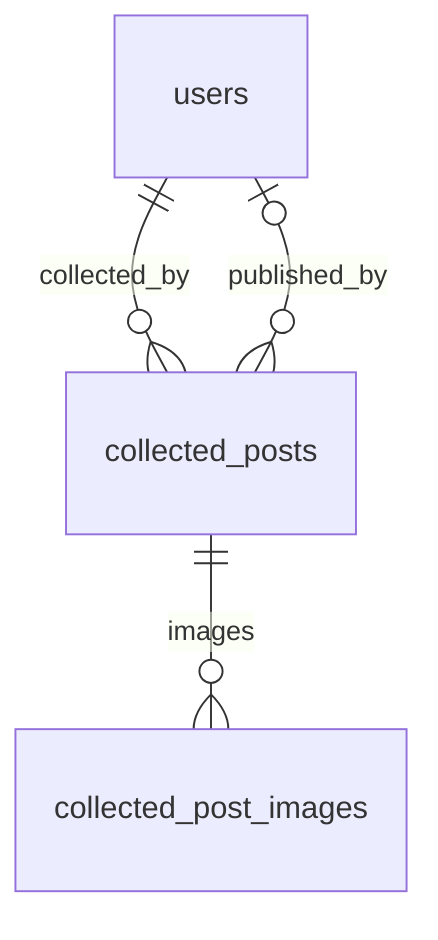

# Bài đăng tổng hợp từ Facebook

## Luồng đã tích hợp

- Navbar **Bài tổng hợp** → `/collected-posts`: khách và mọi vai trò xem bài đã công khai. Mỗi lần tải tối đa 12 bài; `IntersectionObserver` tải tiếp bằng cursor `before`, có nút tải thêm dự phòng. Bộ ảnh không còn giới hạn 2 ảnh; hiển thị carousel có số thứ tự, tải ảnh khi xem, có fallback khi URL nguồn hết hạn.
- Sidebar Staff/Admin → **Bài đăng tổng hợp** → `/staff/collected-posts`: nhập URL nhóm, đăng nhập Facebook, thu thập, xem trước, chọn tối đa 100 bài/lượt để đăng hoặc gỡ công khai. USER/ROOM_HOST bị chặn cả route và API.
- Thu thập chỉ lấy các bài xác định được thời gian trong 24 giờ gần nhất. Kết quả lưu nháp trong MySQL; thu thập lại bỏ qua Facebook post ID đã tồn tại, không ghi đè bài đã đăng. Không có dữ liệu demo trong luồng công khai.
- Bài có tên tác giả, thời gian nguồn, nội dung văn bản, ảnh và link nguồn. React render văn bản, không chèn HTML từ Facebook. Link bài được tạo từ URL nhóm đã kiểm tra và ID số; chỉ giữ ảnh HTTPS từ fbcdn.net/fbsbx.com.
- Đăng/gỡ chạy transaction và khóa bản ghi; danh sách ID có bài không tồn tại bị từ chối toàn bộ. Nhập trùng đồng thời có unique constraint và trả 409 để tải lại/thử lại.
- Card có kích thước ổn định theo breakpoint, font Plus Jakarta Sans giống dự án. Caption chỉ hiển thị 4 dòng trong vùng cố định; nút xem thêm xuất hiện khi nội dung bị tràn và mở native modal có cuộn riêng, không giãn card.
- Trang công khai dùng hero nền tối theo phong cách trang Cộng đồng, thanh giới thiệu feed nổi trên nền xám nhạt, danh sách 2 cột từ 768px và 1 cột trên điện thoại. Cỡ chữ nội dung/nút 14px, tên tác giả 16px, metadata 12px; CSS được giới hạn trong `.collected-discovery`, không đổi trang Cộng đồng hoặc màn hình quản lý.
- Equal Grid: bài không có ảnh bỏ hẳn gallery/placeholder; caption chiếm phần diện tích còn lại trong card và vẫn mở popup khi tràn. Card giữ cùng chiều cao theo breakpoint. Ảnh có hai lớp cùng nguồn: nền `cover` blur 20px, ảnh gốc `contain` sắc nét ở giữa; cả hai đổi theo ảnh carousel hiện tại, lớp nền không được đọc bởi screen reader.
- Staff/Admin có nút đăng/gỡ và xóa từng bài. Xóa có xác nhận, đánh dấu `deleted`, ẩn khỏi cả hai feed và ngăn nhập lại cùng ID. Bài đã xóa không được đăng lại qua API publish.
- Scraper duyệt toàn bộ nhánh album thay vì dừng sớm; gộp ảnh từ các lần nhận GraphQL và DOM, loại rendition trùng theo đường dẫn. Đây là toàn bộ ảnh worker thu được từ dữ liệu Facebook trả về; chưa đảm bảo ảnh Facebook chưa trả hoặc chặn quyền truy cập. Cào lại bổ sung/làm mới bộ ảnh bài nháp đã có. Bài đã công khai cần gỡ công khai → cào lại → kiểm tra → đăng lại để cập nhật ảnh.

## Chạy dịch vụ Python

Python 3.11+ và Chromium của Playwright. Từ thư mục `scraper-python`:

```powershell
python -m venv .venv
.venv/Scripts/python.exe -m pip install -r requirements.txt
.venv/Scripts/python.exe -m playwright install chromium
$env:SCRAPER_API_TOKEN='<chuỗi bí mật tự đặt, giống backend>'
$env:FB_SESSION_FILE='data/facebook-session.json'
.venv/Scripts/python.exe -m uvicorn main:app --host 127.0.0.1 --port 8091 --workers 1
```

Backend Spring cần biến môi trường (IDE: Run Configuration → Environment variables):

```text
SCRAPER_PYTHON_URL=http://127.0.0.1:8091
SCRAPER_API_TOKEN=<cùng giá trị với Python>
```

Không cần thay DB/JWT trong `application.properties`. Các property tương ứng là `scraper.python.url`, `scraper.api-token`. Thiếu token trả 503 có hướng dẫn cấu hình. Python yêu cầu token ở mọi endpoint, không bật CORS, không nhận đường dẫn session từ client. Chạy một worker để lock tài khoản dùng chung có hiệu lực. Khi chạy khác máy/container, dùng địa chỉ nội bộ phù hợp và bảo vệ kết nối nội bộ.

Nhấn **Đăng nhập Facebook** tại trang quản lý: Chromium mở trên **máy chạy Python**, người vận hành tự đăng nhập/2FA. UI kiểm tra trạng thái, có thể hủy, hết hạn sau 5 phút. Phiên lưu trong file riêng đã ignore; không đưa cookie/token vào git hoặc frontend. Sau khi đăng nhập thành công, nhấn **Thu thập bài viết**. Khi deploy server không có desktop, cần chuẩn bị phiên hợp lệ trên máy có desktop và cấu hình `FB_SESSION_FILE`; nút đăng nhập tương tác cần desktop của server.

Facebook có thể yêu cầu xác minh hoặc thay đổi giao diện; API trả lỗi để người vận hành xử lý, không bỏ qua CAPTCHA. Chỉ thu thập nhóm tài khoản được quyền xem. Ảnh là URL nguồn và có thể hết hạn, chưa có kho lưu ảnh lâu dài.

## Dữ liệu và API

JPA thêm `collected_posts` và element collection `collected_post_images`. Backend dùng cơ chế `ddl-auto` hiện có; môi trường không cho Hibernate cập nhật schema dùng [migration MySQL](../sql/collected-posts.sql) trước khi chạy. Chưa chạy script trên MySQL live. Không chỉnh bảng community và các luồng lịch xem phòng/dịch vụ.

Database đã có bảng và không dùng ddl-auto=update: áp dụng một lần [collected-posts-delete.sql](../sql/collected-posts-delete.sql) để thêm cột `deleted` trước khi dùng phiên bản mới.

`collected_posts`: id BIGINT PK; external_id VARCHAR(64) unique; group_url/source_url VARCHAR(512); author VARCHAR(255); caption TEXT; source_published_at/collected_at; published boolean; published_at; collected_by/published_by FK users. Index `(published,id)`. Bảng ảnh: post_id FK, image_order, image_url VARCHAR(2048).

| API | Quyền |
| --- | --- |
| GET `/api/public/collected-posts?before=ID` | Công khai, chỉ bài đã đăng |
| GET `/api/staff/collected-posts?published=false&before=ID` | STAFF, ADMIN |
| POST `/api/staff/collected-posts/scrape` `{groupUrl}` | STAFF, ADMIN |
| POST `/api/staff/collected-posts/publish` hoặc `/unpublish` `{postIds:[]}` | STAFF, ADMIN |
| DELETE `/api/staff/collected-posts/{id}` | STAFF, ADMIN; xóa khỏi feed, giữ ID chống nhập lại |
| POST `/api/staff/collected-posts/auth/login`, `/auth/cancel` | STAFF, ADMIN |
| GET `/api/staff/collected-posts/auth/status` | STAFF, ADMIN |

Feed trả `{posts, nextCursor}` trong `ApiResponse.data`; `nextCursor=null` khi hết. Thứ tự ID thu thập giảm dần ổn định; làm mới trang/feed để xem bài mới được công khai. Bài nháp không xuất hiện trong API công khai. Timestamp UTC, UI hiển thị giờ Việt Nam.



## Kiểm thử

- `CollectedPostTests`: phân quyền, import nháp, dedupe, chuẩn hóa link/ảnh, đăng/gỡ idempotent, cursor, selection atomic và URL không hợp lệ. Dùng H2 và mock worker, không đăng nhập Facebook.
- `node --test frontend/tests/collected-posts.test.js`: contract API public/staff, cursor, publish, lỗi và abort signal.
- Từ root: `python -m unittest discover -s scraper-python -p test_scraper.py`: token nội bộ, URL, khóa phiên, parse thời gian và không nhận demo/sessionPath từ client.

Tích hợp thật với Facebook cần phiên hợp lệ của người vận hành; các test không chứng minh Facebook luôn cho phép hoặc trả đủ mọi bài.

Đối chiếu trong phiên tích hợp 2026-11-19:

Cập nhật card/xóa/album cùng ngày: 6/6 `CollectedPostTests`, 7/7 test Python,
4/4 test API frontend qua; build frontend qua. Test xóa kiểm tra cả STAFF/ADMIN,
ẩn khỏi hai feed, không đăng/nhập lại; test ảnh kiểm tra nhập >2 ảnh và bổ sung
bài nháp. Chưa kiểm tra trực quan popup/card và chưa đối chiếu album Facebook
thật trong trình duyệt. Các kết quả bên dưới là mốc tích hợp trước cập nhật này.

- `CollectedPostTests`: 4/4 qua trên H2. Sau đó thêm handler lỗi kiểu cursor; bản cuối đã chạy `test-compile` thành công. Lượt chạy lại backend (gồm 2 test client HTTP mới) không được cấp quyền nên 2 test client này chưa chạy.
- Python: 5/5 qua bằng môi trường Python của module mẫu, không truy cập Facebook. Frontend API mới: 3/3 qua.
- Build frontend qua; bộ frontend có trước khi thêm 3 test mới đạt 207/211, còn 4 lỗi cũ ở ProfilePage và các assertion routing/prototype.
- Kiểm tra trực quan route mới chưa thực hiện được: trình duyệt từ chối quyền truy cập localhost:5175. Chưa xác nhận responsive, zoom, bàn phím và luồng đăng nhập Facebook thực tế. Chưa chạy migration MySQL live.
