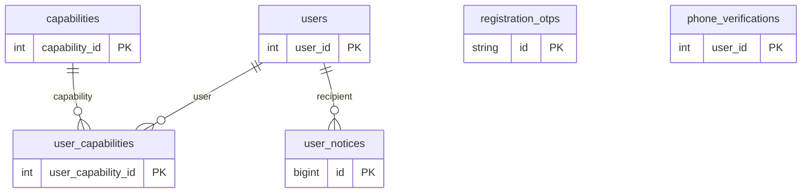
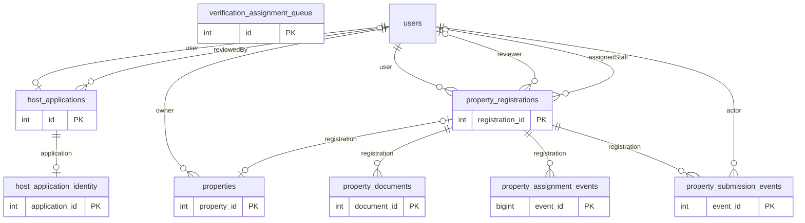
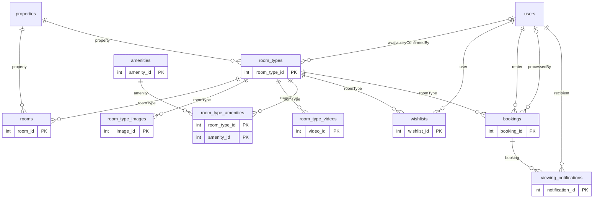
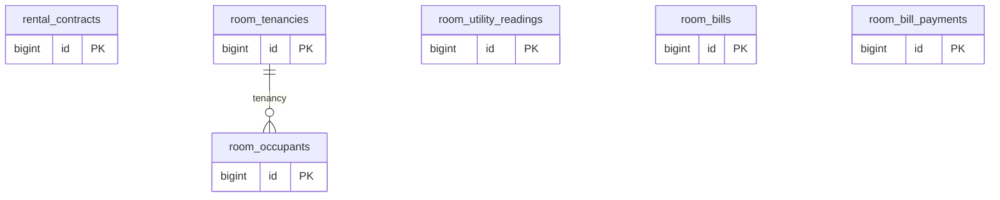
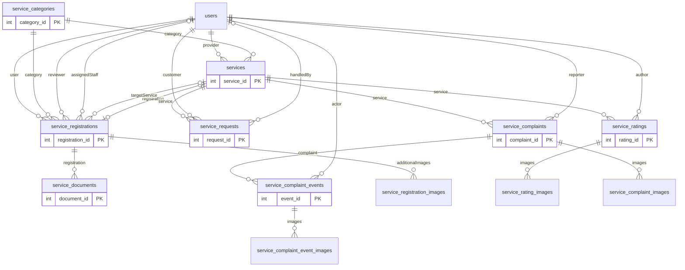

# HL-RCS — ERD theo JPA hiện tại

Đối chiếu source ngày **2026-11-28**: **53 @Entity, 2 @Embeddable và 12 enum độc lập và 6 enum lồng trong entity**. Thay thế sơ đồ snapshot 2026-11-05. Không kiểm tra schema MySQL live.

Node là tên bảng. Cạnh chỉ biểu diễn quan hệ JPA và element collection; ID scalar không tạo cạnh FK. `||` = đúng một, `|o` = không hoặc một, `o{` = không hoặc nhiều. Với quan hệ to-one, optionality lấy từ `nullable=false`, `optional=false` hoặc `@MapsId`; mặc định là optional. Các thuộc tính và index đầy đủ ở [ENTITY_CATALOG.md](ENTITY_CATALOG.md). Quan hệ ngược `mappedBy` không lặp cạnh đã có từ phía sở hữu.

## Tài khoản và quyền

## Nhà trọ và xác minh

## Phòng và lịch xem

## Thuê phòng và hóa đơn

## Dịch vụ

## Cộng đồng và kiểm duyệt

```mermaid
erDiagram
    posts {
        int post_id PK
    }
    post_media {
        int media_id PK
    }
    roommate_post_details {
        int post_id PK
    }
    pass_room_post_details {
        int post_id PK
    }
    pass_item_post_details {
        int post_id PK
    }
    comments {
        int comment_id PK
    }
    community_notifications {
        int notification_id PK
    }
    community_scans {
        int id PK
    }
    community_report_analyses {
        int report_id PK
    }
    community_report_evidence {
        int report_id PK
    }
    collected_posts {
        bigint id PK
    }
    reports {
        int report_id PK
    }
    feedbacks {
        int feedback_id PK
    }
    moderation_logs {
        int log_id PK
    }
    support_requests {
        int request_id PK
    }
    support_logs {
        int log_id PK
    }
    users ||--o{ posts : author
    users |o--o{ posts : reviewer
    posts ||--o{ post_media : post
    posts ||--o| roommate_post_details : post
    properties |o--o{ roommate_post_details : property
    posts ||--o| pass_room_post_details : post
    properties |o--o{ pass_room_post_details : property
    posts ||--o| pass_item_post_details : post
    posts ||--o{ comments : post
    users ||--o{ comments : author
    users ||--o{ community_notifications : recipient
    reports ||--o| community_report_evidence : report
    collected_posts ||--o{ collected_post_images : images
    users ||--o{ collected_posts : collectedBy
    users |o--o{ collected_posts : publishedBy
    users ||--o{ reports : reporter
    users |o--o{ reports : handler
    users ||--o{ feedbacks : user
    properties ||--o{ feedbacks : property
    users ||--o{ moderation_logs : staff
    users ||--o{ support_requests : requester
    properties |o--o{ support_requests : targetProperty
    support_requests ||--o{ support_logs : request
    users ||--o{ support_logs : performedBy
```

## ID scalar và phạm vi sơ đồ

`RentalContract`, `RoomTenancy`, `RoomBill` và các entity khác có ID snapshot/scalar: xem từng field trong catalog. Không vẽ chúng như FK nếu nguồn không khai báo quan hệ. Ràng buộc unique như activeRoomId/contractId và quy tắc transaction nằm trong annotation/service, không được suy ra chỉ từ đường nối ERD.

Bảng ảnh từ `ServiceImage` và các element collection được thể hiện bằng cạnh collection; `ServiceImage` không phải entity độc lập. Không suy rằng xóa node sẽ cascade: kiểm tra annotation cascade và logic soft delete trước khi thay đổi.
