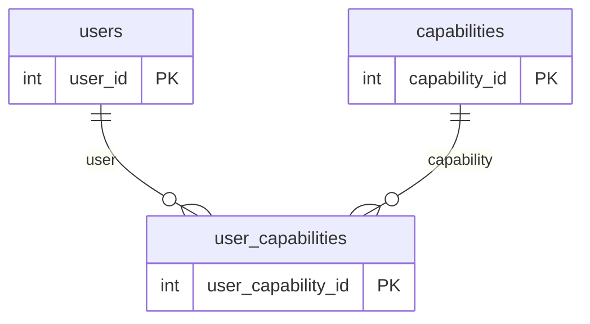
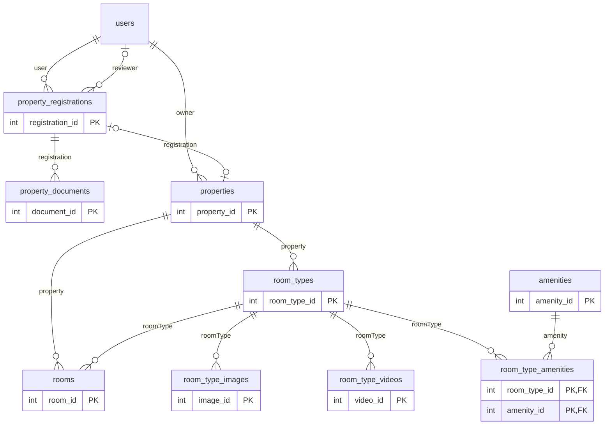
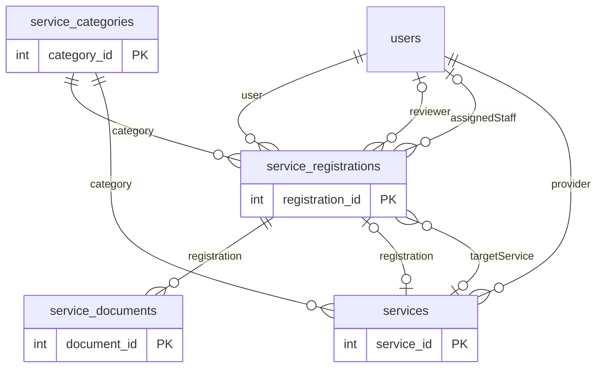
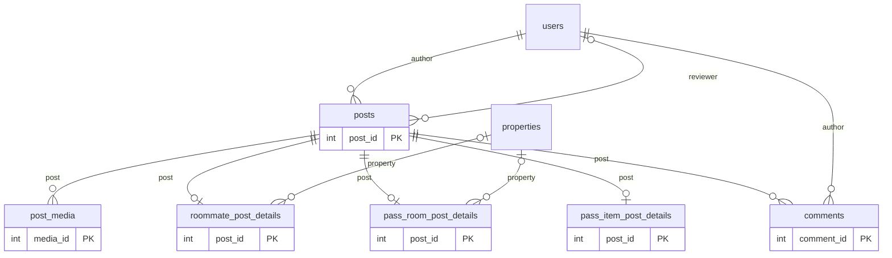
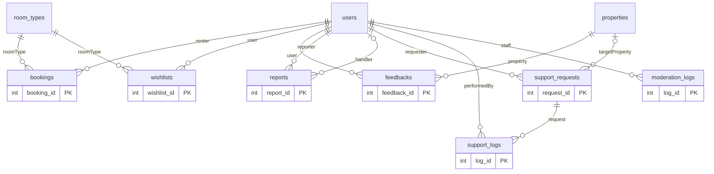
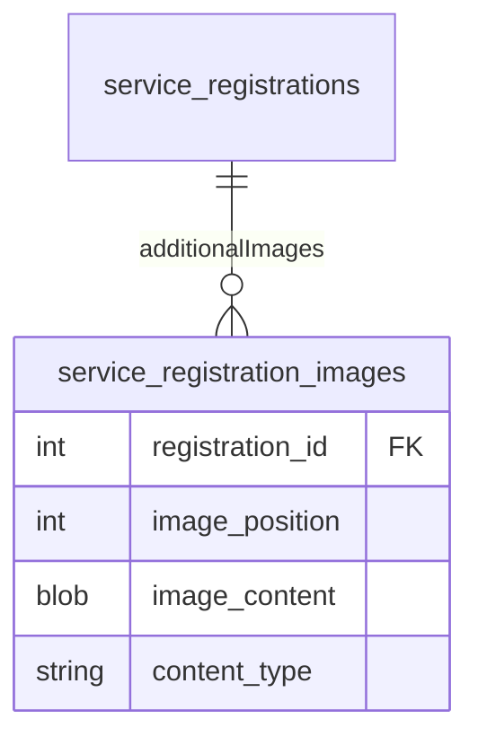

# HL-RCS — ERD theo JPA hiện tại

Đối chiếu ngày **2026-11-05**, commit `350dc13`; **29 entities**, tách thành 5 sơ đồ để dễ đọc.
Nguồn: [entity catalog](ENTITY_CATALOG.md) và `src/main/java/org/hlrcs/entity/`. Không tìm thấy file ERD riêng trong repository trước lượt đọc này; các sơ đồ dưới đây được dựng từ JPA, không phải schema live.

Trong sơ đồ, tên hộp là **tên bảng**. `||` = đúng 1, `o{` = 0..n, `o|`/`|o` = 0..1.
Nhãn cạnh là tên Java relationship. Node ngoài miền được lặp lại để giữ ngữ cảnh. Các attributes scalar đầy đủ nằm trong ENTITY_CATALOG.

## Tài khoản và quyền

## Nhà trọ, loại phòng và phòng vật lý

## Onboarding và dịch vụ công khai

## Cộng đồng

## Tương tác và vận hành

## Các ràng buộc cần đọc cùng ERD

- `User` N–N `Capability` qua UserCapability, có status/grantedAt. Không có entity Provider riêng: `services.provider_id` trỏ `users.user_id`.
- RoomType N–N Amenity qua RoomTypeAmenity với composite PK. RoomType còn có amenitiesJson; ERD không khẳng định hai cách lưu đồng bộ.
- `Property.registration_id` và `Service.registration_id` là OneToOne nullable, tương ứng mỗi hồ sơ có tối đa một kết quả. Owner/provider có thể có nhiều row theo cardinality JPA; quy tắc onboarding có thể chặt hơn trong service.
- `Room` liên kết cả Property và RoomType. Ràng buộc cùng một Property được business service kiểm tra; ERD không biểu diễn được quy tắc liên bảng đó. Room number unique theo Property.
- Booking trỏ RoomType, không phải Room. Wishlist cũng trỏ RoomType; Feedback trỏ Property.
- Các PostDetail dùng PK đồng thời FK tới Post. Đúng subtype theo postType cần business logic; sơ đồ không khẳng định database bảo đảm chỉ một subtype.
- Cạnh assignedStaff là FK lịch sử; quyền xét duyệt dịch vụ hiện không phụ thuộc assignment. Mọi active STAFF/ADMIN được xử lý hồ sơ, trừ tự xét duyệt.
- ModerationLog và Report có targetType/targetId dạng polymorphic; chỉ staff/reporter/handler là các FK được vẽ. Không vẽ FK giả tới các bảng đích.
- Phân biệt cascade trong SQL tham khảo với cascade trong JPA. Không suy ra hành vi xóa từ sơ đồ này.
- Trước thay đổi database, đối chiếu [schema drift](ENTITY_CATALOG.md#khác-biệt-cột-với-sqlschemasql) và kiểm tra schema live nếu được yêu cầu.

## Bổ sung bộ ảnh dịch vụ — 2026-11-08

Bảng collection của embeddable ServiceImage; ảnh đại diện vẫn lưu trên service_registrations. Thứ tự ảnh được giữ bằng image_position.
