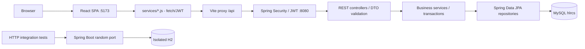

# HL-RCS — context và kiến trúc hiện tại

Ngày đối chiếu: **2026-11-05**. Commit làm mốc: `350dc13`.
Phạm vi: mã nguồn, JPA mappings, cấu hình, API, frontend và test trong repository;
không truy vấn database đang chạy và không xác minh triển khai thực tế.

## 1. Mục tiêu và nguồn đối chiếu

Cập nhật 2026-11-11: [Tái xác minh N05–N08](PROPERTY_REVERIFICATION.md) phân loại
địa chỉ/tọa độ/người quản lý/giấy tờ quan trọng. Property.reverificationRequired
chặn các đường công khai đến khi Staff duyệt đúng phiên bản; yêu cầu bổ sung hoặc
từ chối không tự mở lại. Sửa nội dung thông thường giữ bản đã duyệt công khai.

Cập nhật 2026-11-11: [Xác nhận phòng trống N01–N04](ROOM_AVAILABILITY_CONFIRMATION.md)
thêm mốc UTC/người xác nhận ở RoomType, API xác nhận theo loại phòng, ba trạng thái
UNCONFIRMED/CURRENT/STALE và cảnh báo quá 7 ngày trên host/public. Không lấy
Room.confirmedAt hoặc RoomType.updatedAt làm mốc xác nhận toàn loại.

HL-RCS kết nối người thuê, chủ trọ và nhà cung cấp dịch vụ hỗ trợ tại Hòa Lạc.
Các miền nghiệp vụ gồm tài khoản/quyền, nhà trọ/phòng, lịch xem phòng, dịch vụ,
cộng đồng, hỗ trợ, kiểm duyệt, đánh giá và báo cáo vi phạm.

Ưu tiên đối chiếu khi phát triển:

1. Yêu cầu người dùng mới nhất và chính sách nghiệp vụ đã thống nhất.
2. Controller, service, security, DTO, entity và frontend thực tế.
3. Test liên quan và tài liệu migration theo từng module.
4. README, báo cáo migration ban đầu và SQL tham khảo, sau khi kiểm tra độ cập nhật.

Tài liệu liên quan: [entity catalog](ENTITY_CATALOG.md), [ERD](ERD.md),
[README](../README.md), [frontend README](../frontend/README.md),
[migration notes](../frontend/migration/).

## 2. Kiến trúc triển khai

Ứng dụng hiện tại là một backend monolith theo lớp và một frontend SPA riêng.

Một ngoại lệ thực tế: `PublicServiceController` đọc repository trực tiếp và gọi
`ServicePublicationService` để kiểm tra điều kiện công khai; không phải mọi endpoint
đều có đúng một tầng service trung gian.

| Thành phần | Công nghệ / vị trí |
| --- | --- |
| Backend | Java 17 target, Spring Boot 4.1.1, Maven Wrapper, Lombok |
| Persistence | Jakarta Persistence, Hibernate, Spring Data JPA; MySQL runtime |
| API | Spring Web MVC, Bean Validation, `ApiResponse<T>` |
| Security | Spring Security, BCrypt, JWT/JJWT 0.12.7, method authorization |
| Frontend | React 19.x, React Router 7.x, Vite 7.x, lucide-react, Leaflet |
| Frontend state | React hooks và AuthContext; không có Redux trong package hiện tại |
| Test | Spring Boot HTTP trên cổng ngẫu nhiên + H2; Node native test runner |

Android, Firebase, Google OAuth, Gemini và AWS xuất hiện trong định hướng tổng thể.
Không suy ra chúng đã tích hợp chỉ từ README hoặc dependencies OAuth trong POM.
Mã hiện tại có công cụ tra địa chỉ/bản đồ Google Maps và bản đồ Leaflet; cần đọc
`frontend/migration/GOOGLE-MAPS-SETUP.md` và services tương ứng trước khi sửa.

## 3. Bản đồ mã nguồn

| Đường dẫn | Trách nhiệm |
| --- | --- |
| `src/main/java/org/hlrcs/HlRcsApplication.java` | Spring Boot entry point |
| `configuration/` | Security/CORS, MVC redirects, seed demo accounts/capabilities/categories |
| `security/` | JWT parsing/filter, UserDetails, authorities, 401/403 handlers |
| `controller/` | REST endpoints, request validation, file responses |
| `dto/request/`, `dto/response/` | HTTP contracts; không dùng entity thay DTO tùy tiện |
| `service/` | Business rules, owner isolation, transactions, mapping |
| `service/impl/AuthServiceImpl.java` | Authentication, profile, password và logout |
| `repository/` | JPA queries, metadata projections, pessimistic locks |
| `entity/`, `entity/enums/` | 29 entities, 1 embeddable ID, 11 enums |
| `exception/` | AppException và response error mapping |
| `development/LocalFrontend.java` | Optional Vite child process khi chạy full stack trong IDE |
| `frontend/src/main.jsx`, `App.jsx` | Bootstrap, router, AuthProvider, screen guards |
| `frontend/src/routing/screens.js` | Route registry, role matrix, legacy URL mapping |
| `frontend/src/layouts/PortalLayout.jsx` | Shared public/host/staff/admin shell và navigation |
| `frontend/src/pages/PortalScreens.jsx` | Ghép route với page component |
| `frontend/src/services/` | API calls, multipart, input/response validation |
| `frontend/src/context/AuthContext.jsx` | Current user/session, login/logout/profile |
| `frontend/src/components/`, `styles/` | Shared UI, modals, maps, responsive CSS |
| `frontend/src/fixtures/` | Demo data còn dùng ở các module chưa kết nối |
| `frontend/reference/auth/` | Prototype auth tham khảo, không phải runtime |
| `frontend/migration/`, `scripts/` | Inventory, module notes, browser-check scripts |
| `src/test/`, `frontend/tests/` | Backend HTTP tests và frontend unit/contract tests |
| `sql/schema.sql` | 28 bảng tham khảo cũ; không tự import khi startup |

Trong backend, các service mới thường là concrete Spring services dùng constructor
injection; `AuthService` là interface với implementation riêng. Một số services dùng
`tools.jackson.databind.ObjectMapper`; POM cũng có dependency Jackson cũ, nên không
đổi package ObjectMapper chỉ dựa trên thói quen từ Spring Boot phiên bản khác.

## 4. Identity, role, capability và ownership

- Role của `User`: `USER`, `ROOM_HOST`, `STAFF`, `ADMIN`.
- UserStatus: `ACTIVE`, `INACTIVE`.
- `Capability.code` là quyền nghiệp vụ, liên kết qua `UserCapability` với trạng thái
  và thời điểm cấp. Seed: `MANAGE_POST`, `MANAGE_ROOM`, `MANAGE_SERVICE`,
  `SUPPORT_CHAT`, `MODERATE_CONTENT`.
- Service Owner được biểu diễn bằng `MANAGE_SERVICE`, không thêm role Service Owner.
  USER, ROOM_HOST, STAFF, ADMIN có thể được cấp quyền này mà giữ nguyên role.
- `CustomUserDetails` tạo authorities `ROLE_<role>`, `CAPABILITY_<code>` và `<code>`.
- JWT filter nạp user và capabilities từ database cho mỗi request hợp lệ;
  tài khoản không hoạt động không được xác thực. Backend còn hỗ trợ cookie
  `Authorization`; frontend hiện gửi Bearer header và `credentials: omit`.
- Admin được phép vào host/staff endpoints qua `hasAnyRole`, không phải một cấu hình
  role hierarchy tổng quát. Admin vào host API vẫn chịu truy vấn theo chính user ID
  ở các service ownership hiện tại; không mặc nhiên được đọc mọi nhà trọ.
- Host queries và writes lấy owner từ `AuthService.getCurrentUser()`.
  Thay `ownerId` phía client không mở rộng quyền truy cập.

| Khu vực | Quyền backend hiện tại |
| --- | --- |
| `GET /api/services`, `/api/services/*` | Public |
| `/api/auth/**` | URL filter cho phép; `/me`, profile/password vẫn kiểm tra user trong logic |
| `/api/host/**` | ROOM_HOST hoặc ADMIN, kèm kiểm tra ownership |
| `/api/staff/**` | STAFF hoặc ADMIN |
| `/api/admin/**` | ADMIN; chưa có business admin controller tương ứng UI demo |
| `/api/service-registrations/**` | Authenticated; không đòi sẵn capability dịch vụ |

Frontend guards phục vụ điều hướng/UX. Enforcement thực tế là Spring Security
và business service. Frontend lưu token trong sessionStorage, hoặc localStorage khi
chọn ghi nhớ; `/api/auth/me` xác minh phiên sau reload. HTTP wrapper xử lý JSON,
multipart, blob, validation fields và session expiration; không biến lỗi thành dữ liệu rỗng.

## 5. Entity và ERD cần ghi nhớ

| Nhóm | Entities |
| --- | --- |
| Tài khoản/quyền | User, Capability, UserCapability |
| Nhà trọ/phòng | PropertyRegistration, PropertyDocument, Property, RoomType, Room, RoomTypeImage, RoomTypeVideo, Amenity, RoomTypeAmenity |
| Dịch vụ | ServiceCategory, ServiceRegistration, ServiceDocument, Service |
| Cộng đồng | Post, PostMedia, RoommatePostDetail, PassRoomPostDetail, PassItemPostDetail, Comment |
| Tương tác/vận hành | Booking, Wishlist, Feedback, Report, SupportRequest, SupportLog, ModerationLog |

Các phân biệt quan trọng:

- `PropertyRegistration` là hồ sơ; `Property` là cơ sở được tạo sau duyệt.
- `ServiceRegistration` là hồ sơ; `Service` là nội dung dịch vụ được tạo sau duyệt.
- `RoomType` là loại phòng và thông tin giá/diện tích; `Room` là phòng vật lý.
  Số phòng unique theo `(property_id, room_number)`.
- `Booking` gắn với `RoomType`, biểu diễn lịch xem; không gắn trực tiếp `Room`
  và không tự thay đổi tình trạng có người thuê.
- `Wishlist` gắn `User` với `RoomType`; `Feedback` gắn `User` với `Property`.
- `RoomTypeAmenityId(roomTypeId, amenityId)` là composite ID;
  `RoomTypeAmenity` dùng EmbeddedId + MapsId.
- Ba PostDetail dùng shared primary key `post_id` + MapsId/OneToOne với Post,
  không phải ba bảng con được JPA inheritance tự quản lý.
- `ModerationLog.targetType/targetId` và `Report.targetType/targetId` là polymorphic
  references do application diễn giải; không phải FK tự động tới mọi bảng đích.
- `Service.provider_id` chính là `User.user_id`; không có bảng Provider riêng.
- Nhiều quan hệ là LAZY. Metadata/file endpoints phải giữ transaction đúng chỗ;
  không serialize entity graph và confidential BLOB ra public DTO.
- Business rule một nhà trọ cho mỗi chủ ở onboarding được service kiểm soát;
  không nhầm với unique constraint trên `properties.owner_id`.
- Entity có cả RoomTypeAmenity và `RoomType.amenitiesJson`; không mặc định hai nguồn
  dữ liệu này được đồng bộ. Tương tự có cả URL legacy và binary file storage.

## 6. Luồng nhà trọ và phòng đã nối database

`PropertyRegistrationService` nhận JSON details + photos + ownership + idCard,
fireSafety tùy chọn. Full form lưu ở `registrationDetails`; ảnh/giấy tờ lưu BLOB
trong PropertyDocument. Hồ sơ bắt đầu PENDING, chưa tạo Property.

StaffService hỗ trợ APPROVE, REJECT, REQUEST_SUPPLEMENT. Supplement chuyển
PENDING → NEEDS_SUPPLEMENT và giữ lý do; chưa có supplemental-upload workflow.
Phê duyệt hợp lệ tạo Property ACTIVE, cập nhật tài liệu, reviewer/time và audit.
Luồng này khóa hồ sơ và owner để tránh lặp. Host không gửi lại onboarding khi
đã có Property hoặc hồ sơ đang PENDING/NEEDS_SUPPLEMENT/APPROVED.

Host dashboard/property/type/rooms/viewings đọc dữ liệu theo chủ đang đăng nhập.
RoomType có CRUD, ảnh riêng và kiểm tra property đã duyệt/hoạt động. Room vật lý
có CRUD, kế thừa thông tin từ type, giá riêng tùy chọn, trạng thái VACANT/OCCUPIED.
Không xóa phòng OCCUPIED; không xóa type khi còn liên kết Room hoặc Booking.
Host viewings hiện là API đọc; giao diện không giả lập thao tác confirm/reject.

## 7. Chính sách dịch vụ mới nhất — phải giữ nguyên

Cập nhật 2026-11-08: [SERVICE_MANAGEMENT.md](SERVICE_MANAGEMENT.md) bổ sung nhiều
dịch vụ trên một provider, ảnh đại diện, owner management và proposal CREATE/UPDATE/DELETE.
Nhà cung cấp có capability ACTIVE được gửi thêm dịch vụ; quy tắc một hồ sơ chờ xử lý
chỉ còn áp dụng ở onboarding trước khi có quyền. Mỗi dịch vụ có tối đa một thay đổi
chờ xử lý; bản công khai trỏ snapshot đã duyệt gần nhất cho đến khi thay đổi được duyệt.

Cập nhật vòng bổ sung: xem [SERVICE_SUPPLEMENT.md](SERVICE_SUPPLEMENT.md).
Staff/Admin có thể yêu cầu PENDING → NEEDS_SUPPLEMENT; chủ hồ sơ sửa và nộp lại
trên cùng ID về PENDING. Request/review/resubmit kiểm tra revision để tránh thao tác
từ màn hình cũ. Quyền tài liệu và điều kiện công khai giữ nguyên.

1. Người đăng nhập chưa có capability dịch vụ nộp hồ sơ và dịch vụ đầu tiên.
2. Hồ sơ PENDING lưu applicant, category, name, description, pricing, area,
   contacts và 1–5 tài liệu xác minh. Không cấp quyền/công khai ngay khi nộp.
3. **Mọi STAFF và ADMIN đang hoạt động đều xem và duyệt được hồ sơ, không cần phân công.**
   Không tự duyệt hồ sơ của mình. Các cột assignedStaff/assignedAt giữ dữ liệu cũ,
   không dùng để chặn quyền; API và UI phân công dịch vụ đã được gỡ.
4. Staff/Admin quyết định capability và listing riêng, có lý do 10–2000 ký tự.

| Capability / listing decision | Kết quả |
| --- | --- |
| APPROVE / APPROVE | Cấp/kích hoạt MANAGE_SERVICE; tạo Service ACTIVE |
| APPROVE / REJECT | Cấp/kích hoạt MANAGE_SERVICE; không tạo listing |
| REJECT / REJECT | Từ chối; không cấp quyền/tạo listing |
| REJECT / APPROVE | Không hợp lệ |

`ServiceReviewService` khóa registration và applicant, transaction READ_COMMITTED,
lưu reviewer/reviewedAt/reason/decisions và ModerationLog. Hồ sơ đã xử lý trả conflict
khi bị duyệt lại; hai reviewer đồng thời chỉ một quyết định được lưu.

`ServicePublicationService` là điểm dùng chung kiểm tra public eligibility:

- Service ACTIVE.
- Provider User ACTIVE.
- Registration APPROVED.
- capabilityDecision và listingDecision đều APPROVE.
- Provider có UserCapability MANAGE_SERVICE ACTIVE.

Điều kiện này áp dụng cả list, detail public và kết quả người nộp. `APPROVED`
trên hồ sơ phản ánh quyết định cấp quyền, không đủ để kết luận listing đang công khai.
Không gọi quyền/công khai hiện tại là ACTIVE chỉ vì quyết định trong quá khứ đã duyệt.

Người nộp mở form ở `/services` để xem `providerId`, `serviceId`, `capabilityActive`,
`serviceState`, `publicEligible`, reason, reviewer và reviewedAt. Chỉ người nộp được
tải tài liệu qua endpoint applicant; Staff/Admin dùng endpoint thẩm định riêng.
Public DTO không chứa tài liệu xác minh.

Catalog lấy categories từ database và lọc server-side theo categoryId. Giá có
FIXED/FROM/NEGOTIABLE, server trả `pricingLabel`. Liên hệ dùng tel/mailto thực tế.
Không có booking/order dịch vụ hoặc notification delivery được triển khai bởi luồng này.

## 8. API và frontend hiện có

| API root | Công dụng / frontend |
| --- | --- |
| `/api/auth` | register, login, logout, me, profile, change-password → AuthPage/ProfilePage/AuthContext |
| `/api/host/dashboard` | Dashboard của chủ → HostDashboardPage |
| `/api/host/property` | Property/read và private photos → HostPropertyPage |
| `/api/host/property-registrations` | eligibility/current/submit multipart → HostPropertyCreatePage |
| `/api/host/room-types` | list/detail/create/update/delete, private images → HostRoomTypesPage/modals |
| `/api/host/rooms` | list/create/update/delete → HostRoomsPage/RoomEditorModal |
| `/api/host/viewings` | Danh sách lịch xem theo owner → HostViewingRequestsPage |
| `/api/staff/dashboard` | Queue/audit thực tế, gồm hồ sơ dịch vụ của mọi Staff/Admin |
| `/api/staff/verifications` | Property hồ sơ/list/detail/files/review |
| `/api/service-registrations` | categories/current/submit/documents → ServiceRegistrationModal |
| `/api/staff/service-applications` | list/detail/files/review → StaffServiceApplicationsPage |
| `/api/services` | list/category filter/categories/detail → ServicesCatalog |

Response JSON dùng `{success, message, data, timestamp}`; file endpoint trả binary.
Các request/response chi tiết phải đọc DTO/controller thay vì suy từ tên entity.

Frontend có 33 route entries: 32 legacy screens và route native
`/staff/service-applications` với `source: null`. Các trang thiếu API vẫn còn
fixture/demo: public property search/detail/maps, favorites/bookings/community/
notifications, host property edit/support/notifications, staff community/support,
và business dashboard Admin. Profile có auth thực nhưng một số tab dùng fixture.
Các trường `integration` trong registry và báo cáo migration ban đầu chưa phản ánh
đầy đủ những module đã nối sau đó; kiểm tra imports, API client và endpoint thực tế.

## 9. Database, schema drift và tài liệu cũ

JPA hiện có **29 entities/bảng**, còn `sql/schema.sql` chỉ có **28 bảng** và không
được tự động import. `Room`/`rooms` là bảng bổ sung; nhiều cột upload, registration
details, service decisions và giá/tiện ích room type chưa có trong SQL cũ.
Chi tiết phần thiếu được liệt kê trong [ENTITY_CATALOG.md](ENTITY_CATALOG.md).

Runtime hiện dùng Hibernate `ddl-auto=update`; test dùng `create-drop` trên H2.
Không khẳng định ERD nguồn chính là schema MySQL live: cần kiểm tra live schema
riêng nếu tác vụ sau yêu cầu migration hoặc chẩn đoán database.
SQL `ON DELETE CASCADE` không đồng nghĩa JPA cascade/remove đã được cấu hình.
Không tự import SQL hay chạy cleanup database để "đồng bộ" tài liệu.

## 10. Chạy và kiểm chứng

- Backend: MySQL `hlrcs`, API mặc định 8080; frontend Vite 5173, proxy `/api`
  tới 8080 hoặc `API_TARGET` cấu hình ở môi trường frontend.
- CORS hỗ trợ localhost/127.0.0.1:5173. SPA cần fallback index.html khi deploy.
- Lệnh từ root: `./mvnw.cmd spring-boot:run`; trong frontend:
  `npm install` lần đầu, `npm run dev`, `npm run build`, `npm test`.
- IntelliJ `.run/HL_RCS_Full_Stack.run.xml` chạy main với
  `-Dhlrcs.frontend.enabled=true`; LocalFrontend khởi động Vite sau backend và
  liên kết vòng đời hai process. Build/test không tự khởi động Vite.
- Một số hướng dẫn cũ nhắc đường dẫn `Code/HL-RCS`, run.cmd/start.ps1 ở môi trường
  trước đó; root repository hiện tại là nơi có pom.xml và frontend/.
- Config có optional `config/mysql-local.properties`; không chép secrets vào tài liệu.
- Upload config: 10 MB/tệp, 85 MB/request. Service hồ sơ giới hạn 1–5 tệp;
  property photos có giới hạn riêng trong service, không suy từ global setting.
- Backend test classes: HlRcsApplicationTests (auth), HostDashboardTests
  (host/property/type/room/staff), ServiceRegistrationTests (onboarding/review/public).
- Các test writes dùng H2 riêng và random HTTP port, không dùng MySQL thật.
  Frontend tests dùng `node --test tests/*.test.js`; browser scripts có kiểm tra
  interception nhưng phải đọc từng script trước khi chạy trên dữ liệu thật.
- Kết quả gần nhất trong cuộc trò chuyện trước: 41 backend tests cho host/service,
  63 frontend tests và Vite build đã qua. Đây là kết quả lịch sử; lượt đọc context
  ngày 2026-11-05 không chạy lại test/build.

## 11. Cách dùng bản ghi nhớ

Đọc file này trước, rồi mở entity/service/DTO cụ thể theo tác vụ. Khi sửa mô hình,
policy hoặc trạng thái tích hợp, cập nhật đồng thời tài liệu context/ERD/catalog.
Không dùng số lượng test, trạng thái demo hoặc giả định schema ở đây thay cho
việc kiểm chứng nguồn hiện tại khi có thay đổi mới.
