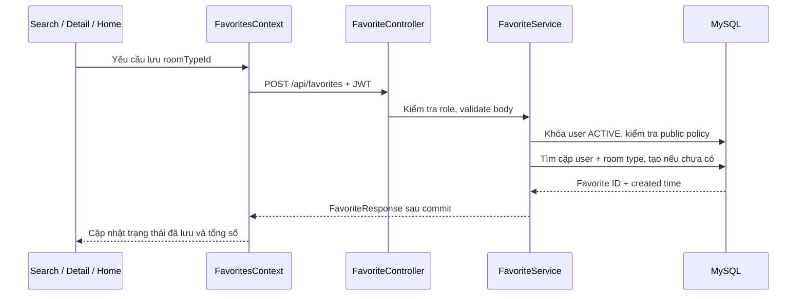

# SDS — Iteration 2: Favorites (Flow 3.1)

Ngày cập nhật: 05/11/2026. Phạm vi: Save Favorite Accommodation, View My Favorites,
Favorite Actions and Page, Verify Favorites Flow.

## Quy tắc nghiệp vụ

- Chỉ tài khoản `USER` (Platform Member) và `ROOM_HOST` đang `ACTIVE` được lưu, xem và bỏ lưu.
  JWT xác định người dùng; client không được chỉ định chủ sở hữu danh sách bằng User ID.
- Đối tượng được lưu là **loại phòng** (`room_type_id`), không phải nhà trọ hay phòng vật lý.
  Hai loại phòng trong cùng một nhà trọ có trạng thái lưu độc lập.
- Chỉ được tạo mục lưu khi loại phòng thỏa `PublicAccommodationPolicy.visible()` của Iteration 1:
  nhà trọ ACTIVE, hồ sơ APPROVED, chủ trọ ACTIVE, giá và diện tích lớn hơn 0.
  Loại phòng hết chỗ vẫn là tin công khai hợp lệ để lưu.
- Gửi lại cùng yêu cầu trả cùng Favorite ID và created time. Không tạo bản ghi trùng.
- Danh sách thuộc riêng tài khoản, sắp theo `created_at DESC, wishlist_id DESC`.
  Nội dung công khai được đọc lại khi xem; không lưu bản sao tên, giá, ảnh hay địa chỉ vào favorites.
- Mục bị ẩn/chưa duyệt/chủ trọ bị khóa vẫn nằm trong danh sách với `available=false` và
  `accommodation=null`. Chỉ trả mã mục lưu, mã loại phòng đã lưu và thời gian lưu của chính tài khoản.
  UI không hiển thị tên, ảnh, giá, địa chỉ hoặc liên kết chi tiết của mục không công khai.
- Bỏ lưu chỉ xóa một hàng `wishlists`. Không cascade từ Wishlist sang RoomType hoặc Room.
  Việc chủ trọ xóa hẳn loại phòng vẫn dùng luồng xóa và dọn wishlist đang có của hệ thống;
  không tạo bản sao thông tin riêng tư để giữ lại sau khi loại phòng đã bị xóa.

## Dữ liệu và đồng thời

Tái sử dụng entity/bảng `Wishlist` / `wishlists`:

| Cột | Ý nghĩa |
| --- | --- |
| `wishlist_id` | Khóa chính, API gọi là `favoriteId` |
| `user_id` | Chủ sở hữu, lấy từ phiên đăng nhập |
| `room_type_id` | FK tới loại phòng |
| `created_at` | Thời gian tạo phía server; giữ nguyên khi gửi lặp |

Ràng buộc DB: `UNIQUE(user_id, room_type_id)` tên `uk_wishlist_user_room_type`.
Không dùng `CascadeType.REMOVE` trên quan hệ từ Wishlist tới user/room type.

Save/remove chạy trong transaction `READ_COMMITTED`, khóa ghi hàng user hiện tại trước khi
đọc/tạo/xóa wishlist. Các yêu cầu cùng tài khoản được tuần tự hóa ngay cả khi chạy trên nhiều
instance backend. `READ_COMMITTED` giúp yêu cầu đợi khóa nhìn thấy kết quả đã commit của yêu cầu trước
trên MySQL, tránh dùng snapshot cũ của `REPEATABLE_READ`. Ràng buộc duy nhất là lớp bảo vệ DB bổ sung.

Với DB đã có dữ liệu, chạy `sql/iteration-2-favorites.sql` trước khi triển khai. Script giữ Favorite ID
nhỏ nhất của mỗi cặp bị trùng rồi thêm unique index nếu chưa tồn tại; có thể chạy lại.
`sql/schema.sql` và annotation entity đã chứa ràng buộc cho DB mới.

## API

Tất cả response thành công bọc bằng `ApiResponse`, có `Cache-Control: private, no-store`.

| API | Dữ liệu / kết quả |
| --- | --- |
| `POST /api/favorites` | Body `{ "roomTypeId": 34 }`; trả FavoriteResponse, HTTP 200 cho cả tạo mới và gửi lặp |
| `GET /api/favorites?page=0&size=6` | `{ items, page, size, totalElements, totalPages }`; page từ 0, size 1–50 |
| `GET /api/favorites/{favoriteId}` | Chỉ trả mục thuộc người dùng hiện tại |
| `GET /api/favorites/state?roomTypeIds=34,35` | Tối đa 50 ID; `{ items: [{ roomTypeId, favoriteId }], total }` để đồng bộ nút và tổng số |
| `DELETE /api/favorites/{favoriteId}` | Xóa mục của chính tài khoản; trả success với data null |

`FavoriteResponse`: `{ favoriteId, roomTypeId, createdAt, available, accommodation }`.
`accommodation` là `AccommodationSummary` dùng chung với Search/Detail, được đọc qua policy public
trước khi chuyển DTO. Không serialize entity JPA, owner, hồ sơ đăng ký hay tài liệu riêng tư.

Lỗi: 400 cho tham số/body không hợp lệ; 401 cho guest hoặc token của tài khoản đã ngừng hoạt động;
403 cho vai trò khác; 404 cho tin không công khai khi lưu hoặc Favorite ID không thuộc tài khoản.
404 của mục người khác giống mục không tồn tại; xóa lặp sau khi đã bỏ lưu trả 404.

## Thành phần và luồng



`FavoritesProvider` nằm trong AuthProvider, dùng state trong bộ nhớ để hiển thị và DB làm nguồn dữ liệu.
Khi đổi tài khoản/đăng xuất, provider được tạo lại; request của phiên trước bị hủy.
Status read cũ không được ghi đè kết quả mutation mới. Nút khóa trong lúc đang đọc trạng thái hoặc
đang lưu/bỏ lưu; lỗi giữ nguyên trạng thái đã xác nhận và cho phép thử lại.

Guest bấm lưu được chuyển sang login với đường dẫn quay lại qua `location.state.from`.
Không tự thực hiện thao tác lưu sau đăng nhập; người dùng quay về trang và bấm lưu.

Search, Detail (kể cả tin tương tự), Home và Favorites dùng chung trạng thái theo roomTypeId.
Home lưu loại phòng công khai được chọn làm đại diện bởi `homeRoomType()` và dẫn tới đúng loại phòng đó.
Không đọc/ghi `hlrcs:public-saved-properties` hoặc dùng fixture cho danh sách yêu thích.
Không chuyển tự động dữ liệu localStorage cũ vì các ID trước đây là property ID, không xác định được
loại phòng mà người dùng muốn lưu.

Trang `/favorites` có loading, empty, error/retry, phân trang trên URL và trạng thái không khả dụng.
Khi bỏ mục cuối ở trang cuối, UI chuyển về trang hợp lệ trước đó. Chỉ đổi nút/tổng số hoặc bỏ card
sau response API thành công. Link xem phòng vẫn dùng cặp propertyId + roomTypeId thật.

## Kiểm thử và bằng chứng

- `FavoriteTests`: lưu và gửi lặp; hai loại phòng cùng nhà trọ; đọc lại giá công khai hiện tại;
  phân trang; danh sách/state riêng; đổi Favorite ID không đọc/xóa mục người khác; kiểm tra role và active;
  12 POST đồng thời; DB từ chối trùng khi bỏ qua service; unavailable khi ẩn/chưa duyệt/chủ trọ ngừng hoạt động;
  bỏ lưu không xóa room type/room.
- `AccommodationTests`: regression của public policy, DTO, chi tiết và ảnh Iteration 1.
  Hai test class khóa trực tiếp datasource H2/create-drop để cấu hình external local không ghi đè.
- `frontend/tests/favorites.test.js`: Authorization, room type/Favorite ID, phân trang, unavailable,
  lỗi mạng/API và response không hợp lệ không biến thành trạng thái thành công.
- `frontend/scripts/check-favorites.cjs`: browser kiểm tra pending không đổi trạng thái sớm, cùng nhà trọ
  không lưu chung hai loại phòng, reload, lỗi bỏ lưu không mất card, loading/empty/error/retry, unavailable,
  phân trang và bỏ mục cuối; guest chuyển login; lưu bằng bàn phím; desktop/mobile 375/768/1024/1440
  và viewport 720 CSS px (không gian bố cục tương đương màn hình 1440 ở zoom 200%).
  Phần smoke MySQL thật dùng tài khoản demo, lưu một loại phòng chưa lưu, xác minh Search → reload →
  Detail → Favorites → bỏ lưu; finally dọn đúng mục lưu tạm.
- Kết quả mới nhất: 16 test backend qua; 3 test service favorites mới qua; browser mock và MySQL thật qua;
  build Vite qua. Kiểm tra thêm 12 POST đồng thời trên MySQL local: đều HTTP 200, cùng một Favorite ID;
  mục lưu tạm đã được bỏ sau test. Migration chạy lại thành công, unique index được xác nhận qua
  information_schema. Bộ frontend chung: 147/151 qua, 4 lỗi có sẵn ở Profile/migration trước thay đổi này.

Lệnh chạy từ root:

```powershell
$env:JAVA_HOME='C:/Program Files/Java/jdk-17'
./mvnw.cmd '-Dtest=FavoriteTests,AccommodationTests' test
node --test frontend/tests/favorites.test.js frontend/tests/accommodations.test.js
```

Browser: chạy backend/Vite local rồi từ `frontend` chạy `node scripts/check-favorites.cjs`.
Có thể đặt `PLAYWRIGHT_MODULE` theo nơi cài Playwright, `FRONTEND_URL` theo Vite và
`FAVORITES_TEST_EMAIL` / `FAVORITES_TEST_PASSWORD` cho tài khoản demo; không dùng tài khoản thật để smoke test.
`SKIP_REAL_FAVORITES=1` chỉ chạy phần mock. Ảnh QA nằm trong `.local/favorites-ui/` (không commit).

## So sánh các loại phòng đã lưu — tối đa 4

- Tại `/favorites`, checkbox trên mỗi card công khai thêm/bỏ lựa chọn so sánh; tối đa **4** loại phòng,
  tối thiểu **2** để mở bảng. Sau khi đủ 4, checkbox của phòng chưa chọn bị vô hiệu hóa; vẫn bỏ chọn được.
- Lựa chọn lưu bằng query `compare=FavoriteID1,FavoriteID2,...`, giữ khi phân trang/reload và tách khỏi
  thao tác lưu/bỏ lưu DB. Bỏ lưu thành công cũng loại mục đó khỏi lựa chọn. Không lưu dữ liệu phòng vào localStorage.
- Thanh chọn cố định hiển thị số lượng, bỏ chọn tất cả và nút So sánh ngay.
- Route bảo vệ `/favorites/compare?ids=...` dành cho USER/ROOM_HOST; từ chối URL chứa quá 4 ID hoặc
  ID không hợp lệ trước khi tải dữ liệu phòng. Guest chuyển đăng nhập.
- Mỗi cột đọc `GET /api/favorites/{favoriteId}` có JWT để xác nhận quyền sở hữu và public state,
  sau đó đọc Detail API công khai hiện có. Không thêm endpoint, bảng hoặc migration mới cho so sánh.
  404 khi mục không thuộc tài khoản/bị bỏ lưu hoặc tin vừa bị ẩn cho cột unavailable; không giữ lại snapshot tên,
  ảnh hay giá. Lỗi mạng/500 hiển thị lỗi riêng cột và có retry; hủy request khi đổi route/tài khoản/lựa chọn.
- Bảng đối chiếu địa chỉ, giá, diện tích, sức chứa, cọc, tiền phòng + cọc, đơn giá điện/nước/internet/dịch vụ,
  phòng trống, tiện nghi và quy định. Giá điện `/kWh`, nước `/m³`, internet `/phòng/tháng`, dịch vụ `/người/tháng`
  theo cùng contract Detail. Thiếu dữ liệu ghi Chưa cập nhật; cọc 0 được giữ nguyên; không suy tổng phí điện/nước.
- Ô xanh chỉ đánh dấu giá/tiền ban đầu thấp nhất hoặc diện tích lớn nhất khi có ít nhất hai giá trị biết rõ và
  có chênh lệch. Không chấm điểm tổng hợp. Tiện nghi chưa khai báo ghi Chưa ghi nhận, không khẳng định không có.
- Bộ lọc Chỉ hiện điểm khác biệt giữ trên URL; bỏ cột không xóa mục yêu thích. Link Thay phòng quay về danh sách
  với các lựa chọn còn lại. Mỗi cột công khai có link chi tiết và liên hệ đúng propertyId/roomTypeId.
- Mobile cuộn ngang trong bảng, cột tiêu chí cố định và một cột phòng vừa phần màn hình còn lại.
  Thanh chọn phòng không gây tràn ngang toàn trang.

Kiểm chứng: `frontend/tests/room-comparison.test.js` có 5 test cho giới hạn ID, quyền truy cập qua Favorite API,
tin bị ẩn/không sở hữu, lỗi/abort và chi phí thiếu/0. `frontend/scripts/check-room-comparison.cjs` kiểm tra browser
với API mô phỏng: 2–4 phòng, giới hạn 4, chọn qua phân trang, reload, khác biệt, bỏ/thay cột, URL quá giới hạn,
unavailable, retry, guest, chỉ GET và kích thước 375/720/768/1024/1440. Không ghi database trong kiểm thử này.
Ảnh QA ở `.local/comparison-ui/`. 13 test service liên quan qua; build qua. Bộ frontend chung hiện 152/156 qua,
vẫn 4 lỗi Profile/migration đã có trước thay đổi.
